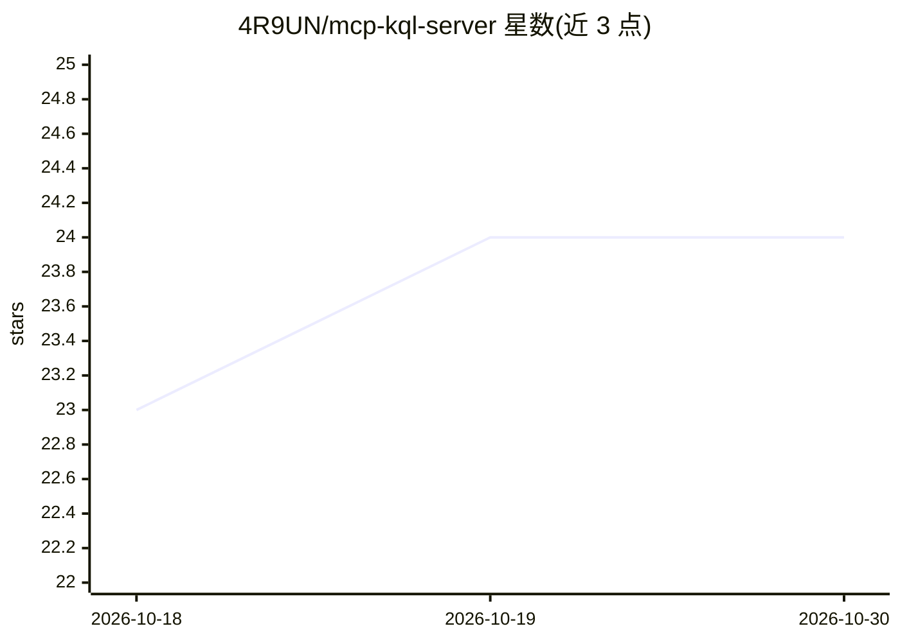

# 4R9UN/mcp-kql-server

⭐ 24 · Python · MIT · 推送 2026-08-03 · [GitHub](https://github.com/4R9UN/mcp-kql-server) · 个人维护

**面向 Azure Data Explorer 的 MCP 服务器：自然语言生成并执行 KQL 查询**

基于 Model Context Protocol 的服务器，连接 Azure Data Explorer 与 Log Analytics：将自然语言转换为 KQL 查询并执行，支持 JSON/CSV/表格输出、执行前严格 schema 校验与基于缓存 schema 的列修复。第二个工具负责集群 schema 的发现、缓存与 CAG 上下文生成，使用 Sentence Transformers（默认 all-MiniLM-L6-v2）做语义检索，查询结果持久化到本地 SQLite。认证依赖 Azure CLI（或托管标识），提供 stdio/HTTP 等多种传输模式，可接入 Claude Desktop、VS Code、Roo-code/Cline 等任意 MCP 客户端。

## 筛选速览

| 维度 | 判定 | 备注 |
|---|---|---|
| AI 角色 | `ai-ecosystem` | LLM/agent 周边工具 |
| 许可风险 | `permissive` | MIT |
| 部署形态 | `desktop` | 安装包/桌面程序 |
| 模型依赖 | — | README 未给出锁定关系 |
| 硬件要求 | — | 无带数字的原话,不猜 |
| 安装摩擦 | `low` | 无编译、无系统依赖或容器化 |
| 成熟度 | — | 结构信号不足 |

## 能力要点

- 自然语言到 KQL（NL2KQL）转换与直接执行，支持 JSON/CSV/表格输出
- 集群 schema 发现、缓存与基于 schema 的查询修复
- 语义检索（Sentence Transformers）与 SQLite 查询结果缓存
- 支持 stdio/HTTP 传输与 Azure CLI/托管标识认证

## 适用场景

- 在 Claude/VS Code 等 MCP 客户端中用自然语言查询 Azure Data Explorer 数据
- 自动发现并缓存 Kusto 集群 schema，生成表级上下文
- 对查询结果生成分析报告与可视化

## 场景标签

`数据分析` · 领域:效率与自动化

## 证据(README 行号)

> L9: A Model Context Protocol (MCP) server that transforms natural language questions into optimized KQL queries with int
> L258: > #### `execute_kql_query` - Execute KQL queries or generate KQL from natural language
> L265: Ask your MCP client (like Claude):

## 星数曲线

2026-10-18 23 → 2026-10-30 24（+1）

---
*卡片 v1 · prompt 1.4 · 生成 2026-10-27 · 置信度 high · 依据 README sha `fcaa9bdb7eb6` · [字段定义](../../DATASET.md)*
