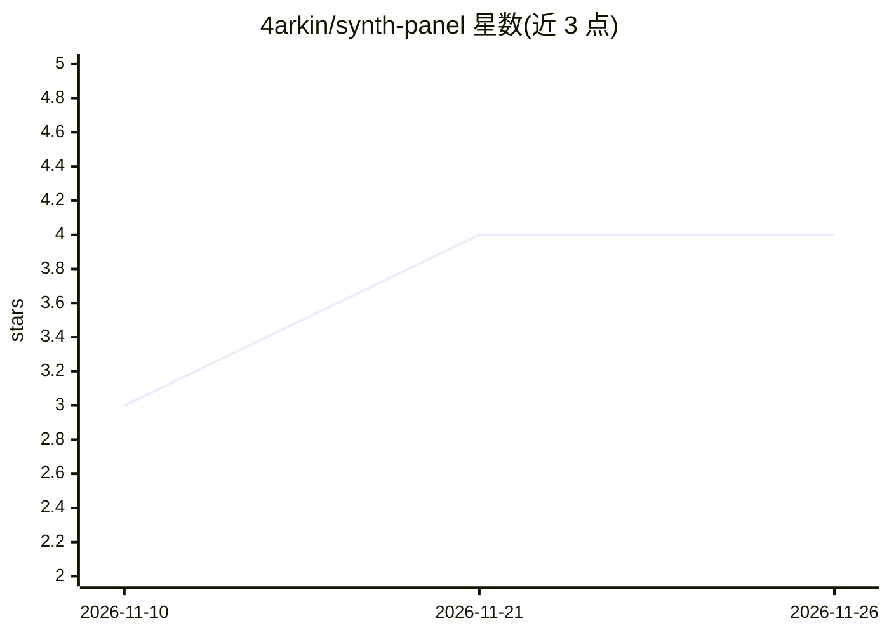

# 4arkin/synth-panel

⭐ 4 · Python · MIT · 推送 2026-11-09 · [GitHub](https://github.com/4arkin/synth-panel) · 个人维护

**给创业者的合成买方评审团：在 AI agent 中测创意/定价/落地页**

synth-panel 让你的 AI agent 从项目构建一组买方角色，每个 persona 在独立进程与空文件夹中运行、互相不可见，从而产生可分歧的独立回答；输出包括排名、按角色的分歧、逐字异议和行动建议。支持概念筛选、backlog 排序、报价/定价测试、落地页走查、访谈与 pre-mortem 等场景，面板在多次运行间轮换。要求 Python 3 与一个 agent CLI，无需 API key，MIT 许可。README 明确其不适用于销售预测或替代与真实买家的沟通。

## 筛选速览

| 维度 | 判定 | 备注 |
|---|---|---|
| AI 角色 | `ai-native` | 本体是模型或模型工具 |
| 许可风险 | `permissive` | MIT |
| 部署形态 | `None` |  |
| 模型依赖 | — | README 未给出锁定关系 |
| 硬件要求 | — | 无带数字的原话,不猜 |
| 安装摩擦 | `low` | 无编译、无系统依赖或容器化 |
| 成熟度 | — | 结构信号不足 |

## 能力要点

- 每个买方 persona 以独立进程+空文件夹运行，保证独立性与可分歧性
- 支持概念筛选、定价测试、落地页走查、访谈、pre-mortem 等多种 run 类型
- 面板跨运行轮换，修订稿面对新读者
- 报告标注证据层级：hypothesis—thin / grounded / evidence-anchored

## 适用场景

- 上线前用自己买家的角色测三个创意哪个值得做
- 检验定价与 offer 中哪一点导致交易失败
- 让面板指出落地页上买家停止阅读的那一行
- 为德国与美国市场分别构建买方面板并比较差异

## 场景标签

 · 领域:市场研究/产品验证

## 证据(README 行号)

> L14: synth-panel gives your AI agent a panel of your own buyers. Your agent builds them from your project, as roles in o
> L86: **Requirements:** Python 3 and an agent CLI. We tested the repo end to end on Claude Code. It ships

## 星数曲线

2026-11-10 3 → 2026-11-26 4（+1）

---
*卡片 v1 · prompt 1.4 · 生成 2026-11-21 · 置信度 high · 依据 README sha `818339ebd8f3` · [字段定义](../../DATASET.md)*
