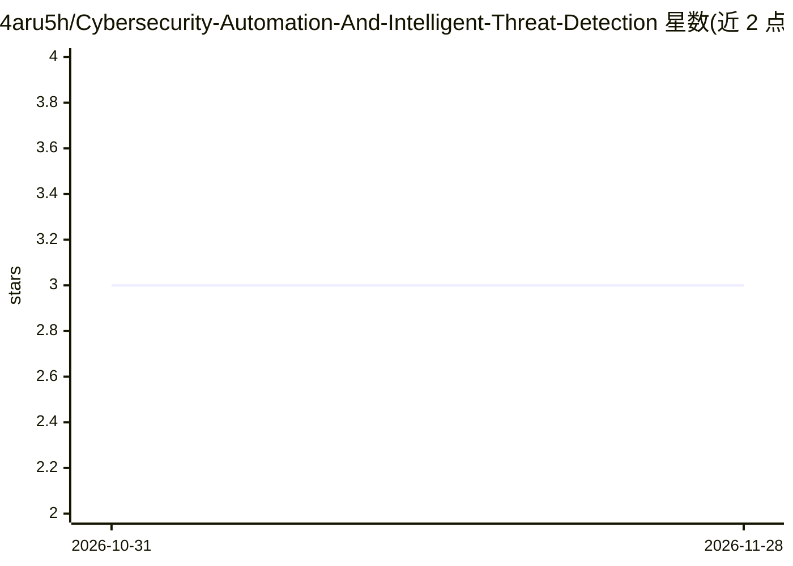

# 4aru5h/Cybersecurity-Automation-And-Intelligent-Threat-Detection

⭐ 3 · Python · MIT · 推送 2026-11-15 · [GitHub](https://github.com/4aru5h/Cybersecurity-Automation-And-Intelligent-Threat-Detection) · 个人维护

**面向安全学习者的自动化 SOC、ML 日志异常检测与加固 API 项目集**

作者完成 iHub DivyaSampark（IIT Roorkee）AI 安全课程的作品，包含三个模块：多线程 TCP 端口扫描与 VirusTotal 威胁情报富化、随机森林与孤立森林对比的日志异常检测、按 PTES 标准对隔离实验网络做的渗透测试审计，以及按 STRIDE 威胁建模设计的 Flask REST API（Bcrypt 哈希、参数化查询、滑动窗口限流）。附带 53 个自动化测试与 bandit SAST 验证，MIT 许可。

## 筛选速览

| 维度 | 判定 | 备注 |
|---|---|---|
| AI 角色 | `ai-native` | 本体是模型或模型工具 |
| 许可风险 | `permissive` | MIT |
| 部署形态 | `library` | 以包/库形式分发 |
| 模型依赖 | — | README 未给出锁定关系 |
| 硬件要求 | — | 无带数字的原话,不猜 |
| 安装摩擦 | `low` | 无编译、无系统依赖或容器化 |
| 成熟度 | — | 结构信号不足 |

## 能力要点

- RandomForest 与 IsolationForest 对比的日志异常检测
- VirusTotal API v3 威胁情报富化（含离线 mock 模式）
- 按 PTES 标准记录的实验网络渗透测试审计
- STRIDE 建模的加固 Flask API 与 53 个测试、bandit SAST

## 适用场景

- 学习 SOC 自动化与日志异常检测的实现方式
- 参考 STRIDE 威胁建模加固 Flask REST API
- 复现隔离实验网络环境下的 PTES 渗透测试流程

## 场景标签

`网络安全` · 领域:学习与行业

## 证据(README 行号)

> L5: It brings together automated reconnaissance tools, machine learning for log anomaly detection, a PTES-compliant pene
> L13:  - Anomaly detection comparing `RandomForestClassifier` and unsupervised `IsolationForest` on log features.

## 星数曲线

2026-10-31 3 → 2026-11-28 3（+0）

---
*卡片 v1 · prompt 1.4 · 生成 2026-11-22 · 置信度 mid · 依据 README sha `52720cabf5e4` · [字段定义](../../DATASET.md)*
