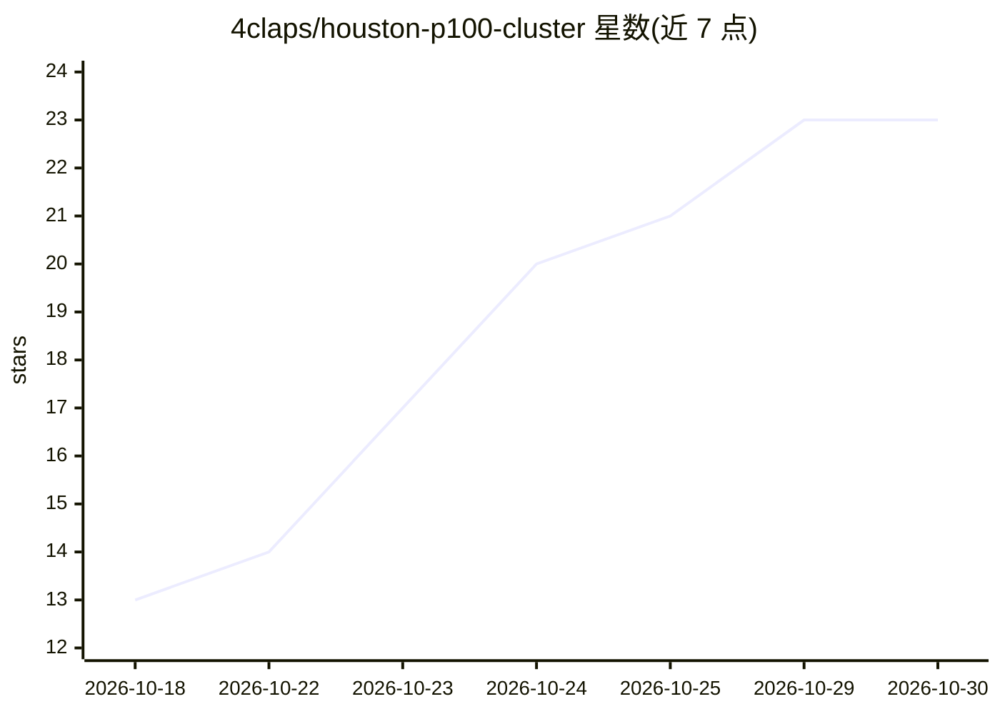

# 4claps/houston-p100-cluster

⭐ 23 · Cuda · 推送 2026-10-22 · [GitHub](https://github.com/4claps/houston-p100-cluster) · 个人维护

**四卡 Tesla P100 本地 LLM 推理服务器的搭建与基准测试文档**

记录代号 houston 的本地推理服务器的构建笔记：旧 NAS 改造为搭载四块 Tesla P100 16GB（64GB VRAM）的专用推理机，含 BIOS 修改说明。生产环境通过 Docker Compose 运行 Kmic-68 的 llama.cpp P100 fork（CUDA+NCCL，张量切分），服务 Qwen3.8-27B Q6 量化模型，给出提示处理 514 tokens/s、生成 42.1 tokens/s 等实测数据及多组配置对比。仓库仅含文档，无 Ansible 或配置脚本。

## 筛选速览

| 维度 | 判定 | 备注 |
|---|---|---|
| AI 角色 | `ai-knowledge` | 知识聚合/清单类 |
| 许可风险 | `none` | — |
| 部署形态 | `self-host` | docker 或自建部署 |
| 模型依赖 | — | README 未给出锁定关系 |
| 硬件要求 | — | 无带数字的原话,不猜 |
| 安装摩擦 | `low` | 无编译、无系统依赖或容器化 |
| 成熟度 | — | 结构信号不足 |

## 能力要点

- 四卡 P100 张量切分运行 llama.cpp fork（Docker Compose 部署）
- 实测性能数据：pp 514 tokens/s、生成 42.1 tokens/s（MTP）
- 记录非常规 BIOS 修改与逐项调参依据
- 9 任务×3 的 agent 电池测试：26/27 通过

## 适用场景

- 参考旧 GPU 搭建本地 LLM 推理服务器
- 查阅 P100 多卡场景的 llama.cpp 调参与量化对比数据
- 了解 MTP 投机解码与 KV cache 量化的实测取舍

## 场景标签

`推理引擎` `教程课程` · 领域:学习与行业

## 证据(README 行号)

> L67: This repo is documentation only — no Ansible, no provisioning scripts. It
> L3: Documentation for `houston`, an NVIDIA Tesla P100 16GB local

## 星数曲线

2026-10-18 13 → 2026-10-30 23（+10）

---
*卡片 v1 · prompt 1.4 · 生成 2026-10-28 · 置信度 mid · 依据 README sha `382320bd3d6e` · [字段定义](../../DATASET.md)*
