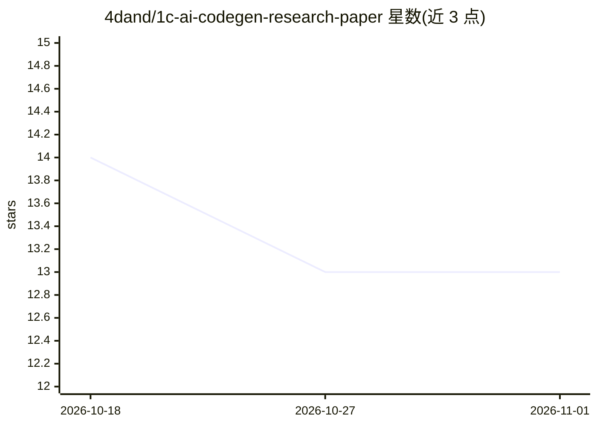

# 4dand/1c-ai-codegen-research-paper

⭐ 13 · 1C Enterprise · NOASSERTION · 推送 2026-04-02 · [GitHub](https://github.com/4dand/1c-ai-codegen-research-paper) · 个人维护

**对比 LLM 生成 1C/BSL 代码的研究论文与可复现实验数据集**

科学竞赛（俄罗斯国家财富-2026）参赛研究档案：比较 Claude Opus 4.5、GPT-5.2 Codex、Gemini 3 Flash 三模型在 1С:Предприятие 8 的 BSL 语言代码生成上的表现，覆盖无元数据上下文的算法任务（A）与经 MCP 提供元数据上下文的平台任务（Б）两类共 10 题。提出 SMOP 四维评分法（语法/语义/优化/平台），由专家按 0-10 偶数档人工评分并汇总为 Q 值。实验工具 GenLab-1C 另仓发布，本仓库仅存论文 PDF、配置与数据；作者声明仓库仍在补充部分工件。

## 筛选速览

| 维度 | 判定 | 备注 |
|---|---|---|
| AI 角色 | `ai-knowledge` | 知识聚合/清单类 |
| 许可风险 | `none` | NOASSERTION |
| 部署形态 | `None` |  |
| 模型依赖 | — | README 未给出锁定关系 |
| 硬件要求 | — | 无带数字的原话,不猜 |
| 安装摩擦 | `low` | 无编译、无系统依赖或容器化 |
| 成熟度 | `idea` | |

## 能力要点

- SMOP 四维评估框架（S/M/O/P，偶数档 0-10 分，Q 为等权均值）
- 两类任务 10 题：算法任务与经 MCP 提供元数据上下文的 УТ11 平台任务
- 三模型经 OpenRouter 统一网关测试，temperature=0 / seed 固定
- 附 7 项研究局限声明（样本量、单一配置、无无-MCP 对照组等）

## 适用场景

- 查阅 LLM 在 1C 平台代码生成上的量化对比结果
- 复用 SMOP 评分标准做 BSL 生成代码的专家评估
- 引用领域专用语言代码生成评测方法论的论文数据

## 场景标签

`代码生成` `模型评测` · 领域:编码与开发

## 证据(README 行号)

> L20: Исследование посвящено **сравнительной оценке больших языковых моделей (LLM) при автоматической генерации кода на я
> L236: **Benchmarking LLM Code Generation for 1C:Enterprise 8 (BSL Language)**

## 星数曲线

2026-10-18 14 → 2026-11-01 13（-1）

---
*卡片 v1 · prompt 1.4 · 生成 2026-10-31 · 置信度 high · 依据 README sha `de4a485eb05d` · [字段定义](../../DATASET.md)*
