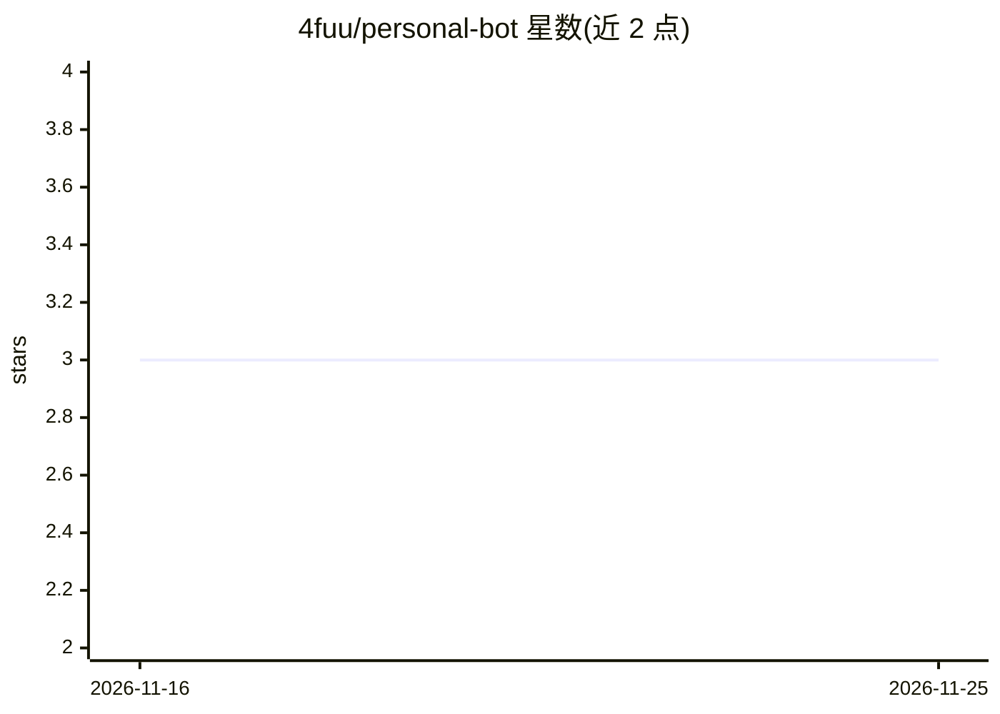

# 4fuu/personal-bot

⭐ 3 · JavaScript · NOASSERTION · 推送 2026-11-03 · [GitHub](https://github.com/4fuu/personal-bot) · [官网](https://4fuu.github.io/personal-bot/) · 个人维护 · 中文 README

**自托管的 QQ 个人聊天助手，容器化运行并带长期记忆**

面向想在自己机器上运行个人助理的用户：通过四容器栈驱动 Linux 版 QQ NT 桌面客户端，从其本地数据库读取消息并经客户端原发送路径回复，支持富文本、图片、语音、合并转发等。助手以单长会话处理回合，用带 token 预算的上下文窗口滚动加笔记式长期记忆，可搜索历史、执行沙箱内 shell 命令、接入 MCP 服务器与已安装技能，并由 Jev 对外发内容做结构化审查。需 Linux x86_64、Docker/Podman、约 2GB 内存，且驱动第三方客户端可能违反其服务条款。

## 筛选速览

| 维度 | 判定 | 备注 |
|---|---|---|
| AI 角色 | `ai-native` | 本体是模型或模型工具 |
| 许可风险 | `none` | NOASSERTION |
| 部署形态 | `desktop` | 安装包/桌面程序 |
| 模型依赖 | — | README 未给出锁定关系 |
| 硬件要求 | — | 无带数字的原话,不猜 |
| 安装摩擦 | `low` | 无编译、无系统依赖或容器化 |
| 成熟度 | — | 结构信号不足 |

## 能力要点

- 四容器架构：客户端、助手、Web 控制台、隔离沙箱
- 上下文窗口滚动交接 + 笔记式长期记忆
- 沙箱仅经域名过滤代理出网，隔离敏感数据
- 支持 MCP 服务器接入与 Jev 外发审查门控

## 适用场景

- 在私人 QQ 账号上托管一个能自然聊天的助手
- 让助手记住长期上下文并按时跟进任务
- 给助手接入网页搜索、shell 与 MCP 外部工具

## 场景标签

`聊天机器人` `AI 助手` `Agent 记忆` · 领域:Agent 开发

## 证据(README 行号)

> L5: **A self-hosted personal assistant that runs on your own machine, stores its
> L58: - **Chat naturally.** Replies to private messages and group @mentions; in groups
> L93: Instead of an ever-growing transcript, working memory is organized as a sequence

## 星数曲线

2026-11-16 3 → 2026-11-25 3（+0）

---
*卡片 v1 · prompt 1.4 · 生成 2026-11-22 · 置信度 mid · 依据 README sha `e855ff6b94fe` · [字段定义](../../DATASET.md)*
