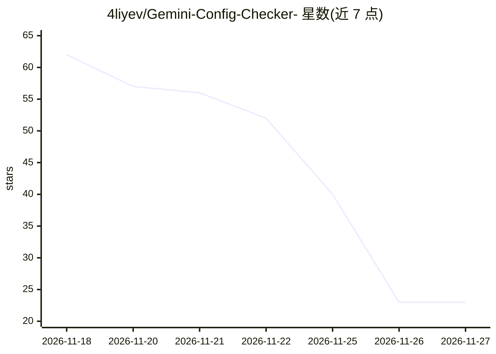

# 4liyev/Gemini-Config-Checker-

⭐ 23 · Go · Apache-2.0 · 推送 2026-11-19 · [GitHub](https://github.com/4liyev/Gemini-Config-Checker-) · 个人维护

**为需要访问 Google AI Studio/Gemini 的用户检测可用代理配置**

桌面/Web 应用，通过真实登录浏览器的路径逐一测试代理配置能否进入 AI Studio 与 Gemini，输出每个配置的区域可用性与延迟。提供 Simple/Advanced 两种模式：前者直接批量测试用户已有配置，后者将免费配置串联到基础配置之后测试其他出口。内置 anti-DPI 配置（fragment 分片、指纹、ALPN、加密套件）与本地分片转发器，导出支持链接、base64 与 Xray 配置。区域检查依赖 Chrome/Edge/Brave，Android 仅支持连通性模式。

## 筛选速览

| 维度 | 判定 | 备注 |
|---|---|---|
| AI 角色 | `ai-enhanced` | 去掉 AI 部分产品仍成立 |
| 许可风险 | `permissive` | Apache-2.0 |
| 部署形态 | `desktop` | 安装包/桌面程序 |
| 模型依赖 | — | README 未给出锁定关系 |
| 硬件要求 | — | 无带数字的原话,不猜 |
| 安装摩擦 | `medium` | 含编译或系统依赖之一 |
| 成熟度 | `idea` | |

## 能力要点

- 以登录账号的浏览器路径读取 Google 的真实区域判定（20–40 秒/配置）
- Simple/Advanced 双模式，支持 base→free 的链式出口测试
- 可编辑的 anti-DPI 配置与本地 fragment 分片转发器
- 多平台分发：Windows/macOS/Linux 桌面与 Web server 构建、Android APK

## 适用场景

- 批量检测手中的代理配置哪些能进 AI Studio/Gemini
- Cloudflare 配置能连通但出口被 Google 拦时寻找替代出口
- 依赖某配置前先验证其真实可用性

## 场景标签

`浏览器自动化` · 领域:效率与自动化

## 证据(README 行号)

> L11: Find proxy configs that actually get you into **Google AI Studio and Gemini**, by testing each one the way a person
> L64: |Platform|Desktop app (native window)|Web server (UI in your browser)|Region check|
> L155: |Check type|Region with signed-in browser|**Region**: opens AI Studio and Gemini and reads Google's verdict (accur

## 星数曲线

2026-11-18 62 → 2026-11-27 23（-39）

---
*卡片 v1 · prompt 1.4 · 生成 2026-11-20 · 置信度 mid · 依据 README sha `08aa4405fbe0` · [字段定义](../../DATASET.md)*
