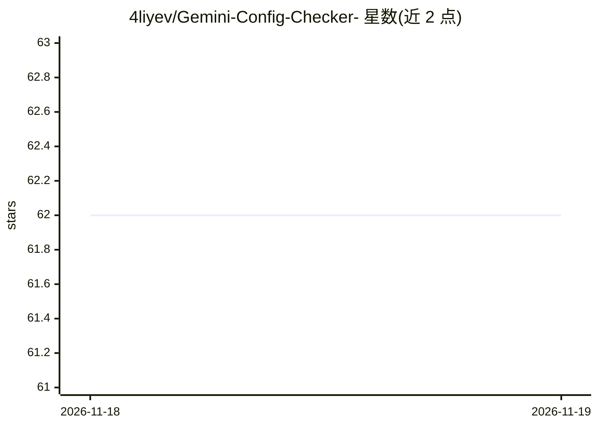

# 4liyev/Gemini-Config-Checker-

⭐ 62 · Go · Apache-2.0 · 推送 2026-11-18 · [GitHub](https://github.com/4liyev/Gemini-Config-Checker-) · 个人维护

**给需要访问 Google AI Studio 与 Gemini 的用户：检测代理配置能否过区域限制**

桌面/Web/Android 应用，通过已登录浏览器逐一测试代理配置（vless/vmess/trojan/ss 链接、订阅 URL 或 base64）能否进入 AI Studio 与 Gemini，读取 Google 对登录账号展示的区域判定，而非仅做连通性探测。提供 Simple（检测自有配置）与 Advanced（把免费配置链接到可用基础配置后链式测试）两种模式，内置可编辑的 anti-DPI（fragment/fingerprint/ALPN/cipher）配置，输出健康状态、区域封锁详情与延迟，支持导出链接、base64 与 Xray 配置。应用内嵌 Xray-core 引擎。仅 Windows 经过实测，macOS/Linux/Android 构建未经真机验证。

## 筛选速览

| 维度 | 判定 | 备注 |
|---|---|---|
| AI 角色 | `ai-ecosystem` | LLM/agent 周边工具 |
| 许可风险 | `permissive` | Apache-2.0 |
| 部署形态 | `desktop` | 安装包/桌面程序 |
| 模型依赖 | — | README 未给出锁定关系 |
| 硬件要求 | — | 无带数字的原话,不猜 |
| 安装摩擦 | `medium` | 含编译或系统依赖之一 |
| 成熟度 | `idea` | |

## 能力要点

- 以登录浏览器读取 Google 区域判定，而非仅 HTTP 连通性探测
- Simple/Advanced 两种模式，Advanced 支持免费配置链式到基础配置
- 可编辑的 anti-DPI 配置（Finalmask fragment、fingerprint、ALPN、cipher suites）
- 导出链接、base64 或完整/链式 Xray 配置

## 适用场景

- 批量检测手头的代理配置哪些能进入 AI Studio 与 Gemini
- Cloudflare 配置连通但出口被 Google 封锁时，寻找可用出口
- 依赖代理访问 Gemini 前先验证配置可用性

## 场景标签

 · 领域:网络工具/代理检测

## 证据(README 行号)

> L9: # Gemini Config Checker
> L11: Find proxy configs that actually get you into **Google AI Studio and Gemini**, by testing each one the way a person
> L14: > **Version 0.1.0, early pre-release.** It works end to end on Windows (the only platform it has been run on so far

## 星数曲线

2026-11-18 62 → 2026-11-19 62（+0）

---
*卡片 v1 · prompt 1.4 · 生成 2026-11-19 · 置信度 high · 依据 README sha `7119c240ac42` · [字段定义](../../DATASET.md)*
