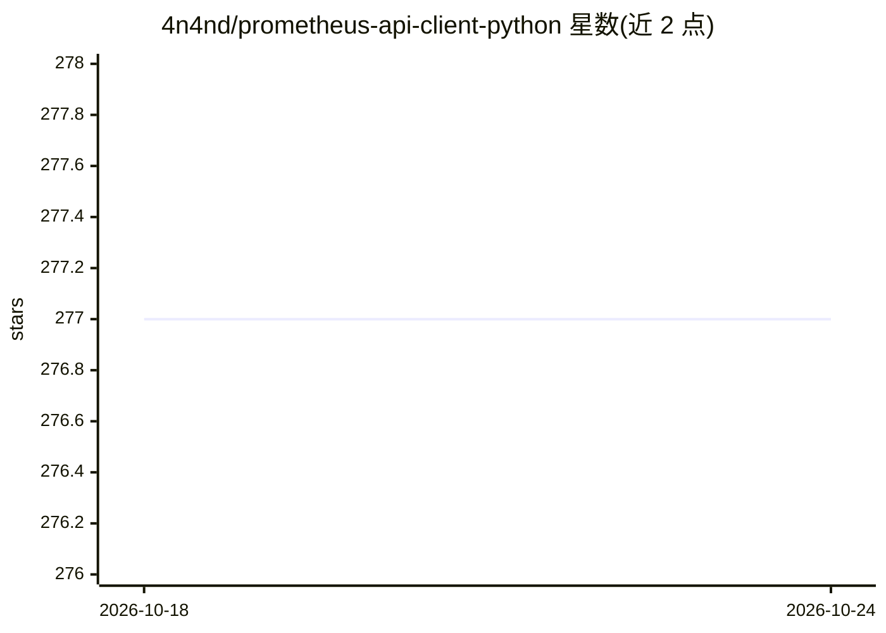

# 4n4nd/prometheus-api-client-python

⭐ 277 · Python · MIT · 推送 2026-10-24 · [GitHub](https://github.com/4n4nd/prometheus-api-client-python) · 组织维护

**Prometheus HTTP API 的 Python 封装库，用于获取与处理监控指标**

对 Prometheus HTTP API 的 Python 封装：PrometheusConnect 模块连接 Prometheus 主机、列出全部指标、按标签配置或自定义 PromQL 查询获取时间序列数据（支持按时间分块）；MetricsList/Metric 模块将查询结果初始化为 Metric 对象，支持指标相加、相等比较与绘图；另提供 MetricSnapshotDataFrame 与 MetricRangeDataFrame 两个模块将指标转为 pandas DataFrame。0.7.0 起 pandas/numpy/matplotlib 为可选依赖，可按 extras 分装以减小安装体积。面向需要读取和分析 Prometheus 监控数据的开发者。

## 筛选速览

| 维度 | 判定 | 备注 |
|---|---|---|
| AI 角色 | `ai-enhanced` | 去掉 AI 部分产品仍成立 |
| 许可风险 | `permissive` | MIT |
| 部署形态 | `library` | 以包/库形式分发 |
| 模型依赖 | — | README 未给出锁定关系 |
| 硬件要求 | — | 无带数字的原话,不猜 |
| 安装摩擦 | `low` | 无编译、无系统依赖或容器化 |
| 成熟度 | — | 结构信号不足 |

## 能力要点

- PrometheusConnect 连接主机并按 PromQL/标签配置获取时间序列（支持时间分块）
- Metric 对象支持相加、相等比较与折线绘图
- MetricSnapshotDataFrame/MetricRangeDataFrame 将指标转为 pandas DataFrame
- pandas/numpy/matplotlib 为可选依赖，支持 dataframe/analytics/plot 分项安装

## 适用场景

- 在 Python 中读取 Prometheus 采集的监控时间序列做分析
- 将指标查询结果转为 pandas DataFrame 做数据处理
- 对多个指标时间序列做聚合与可视化

## 场景标签

`数据分析` · 领域:效率与自动化

## 证据(README 行号)

> L5: A Python wrapper for the Prometheus http api and some tools for metrics processing.
> L40: The `prometheus-api-client` library consists of multiple modules which assist in connecting to a Prometheus host, f

## 星数曲线

2026-10-18 277 → 2026-10-24 277（+0）

---
*卡片 v1 · prompt 1.4 · 生成 2026-10-22 · 置信度 low · 依据 README sha `0d60890b5ebe` · [字段定义](../../DATASET.md)*
