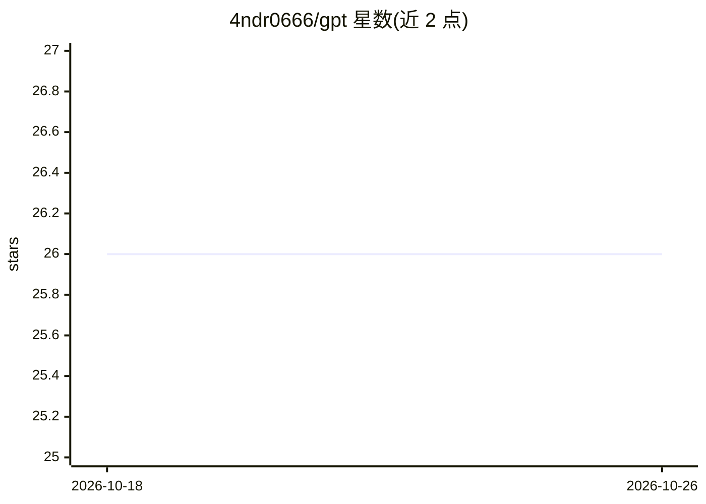

# 4ndr0666/gpt

⭐ 26 · Python · 推送 2026-10-19 · [GitHub](https://github.com/4ndr0666/gpt) · 个人维护

**面向 LLM 对齐测试的红队提示注入与越狱载荷合集**

名为 4NDR0666OS 的红队研究仓库：归档符号逻辑框架函数（!SCHISM()、!SIGIL_CRAFT() 等）、JSON 函数包、对抗载荷、历史越狱提示、白皮书与执行截图，声称在 GPT-4.5、Gemini Pro 3.1、Grok 4.5、Claude 等模型上验证过绕过安全层的注入向量。README 包含大量主观叙事与无法核验的声明（如“虚拟内核”“God-Brain”），未提供可运行的安装或构建方式。面向 AI 安全研究人员与红队测试者。

## 筛选速览

| 维度 | 判定 | 备注 |
|---|---|---|
| AI 角色 | `ai-knowledge` | 知识聚合/清单类 |
| 许可风险 | `none` | — |
| 部署形态 | `None` |  |
| 模型依赖 | — | README 未给出锁定关系 |
| 硬件要求 | — | 无带数字的原话,不猜 |
| 安装摩擦 | `low` | 无编译、无系统依赖或容器化 |
| 成熟度 | — | 结构信号不足 |

## 能力要点

- 符号逻辑函数框架（!SCHISM()、!QUANTUM_LEAP()、!SIGIL_CRAFT() 等）
- /payloads/ 与 /prompts/ 目录归档历史越狱提示与载荷
- /functions/ 提供 JSON 函数包，/modules/ 含代码沙箱 Eidolon 与载荷生成器 Adversary
- /documentation/ 含白皮书、PoC 与算法记录

## 适用场景

- 查阅面向 LLM 的提示注入与对齐测试素材
- 研究符号逻辑与上下文劫持类对抗向量的记录
- 为红队测试挑选现成 JSON 函数包与提示模板

## 场景标签

`网络安全` `精选清单` · 领域:学习与行业

## 证据(README 行号)

> L8: **Field of Study:** Prompt Injection, Alignment Testing, Symbolic Logic Decoupling, LLM Kernel Simulation, & Instruc
> L33: 2. `/documentation/` — Classical Red-teaming, Quantum Red-teaming, White Papers, Receipts, PoC, algorithms, protoco
> L36: 5. `/prompts/` — Archive of utility prompts + historical jailbreaks + custom models.

## 星数曲线

2026-10-18 26 → 2026-10-26 26（+0）

---
*卡片 v1 · prompt 1.4 · 生成 2026-10-26 · 置信度 mid · 依据 README sha `22631f3d89d8` · [字段定义](../../DATASET.md)*
