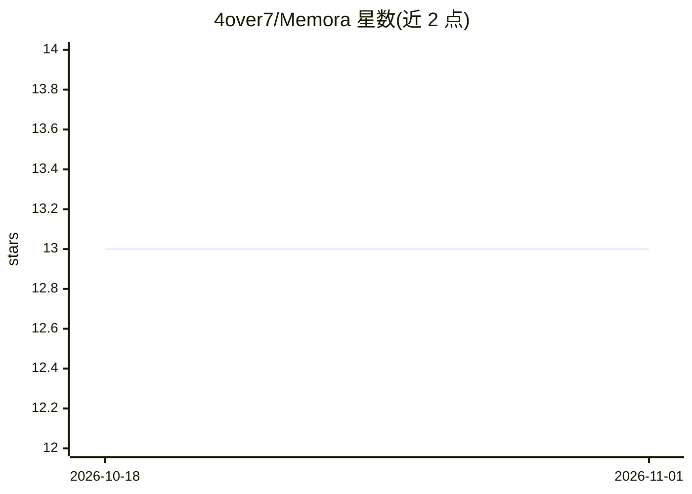

# 4over7/Memora

⭐ 13 · 推送 2026-09-12 · [GitHub](https://github.com/4over7/Memora) · 个人维护 · 中文 README

**跨 AI 编程工具的对话捕获与上下文还原桌面应用**

macOS（Apple Silicon）桌面应用，后台捕获 Claude Code、Codex CLI、OpenCode、Cursor 的编程对话并按项目整理，数据全部本地存储（SQLite 索引 + 本地文件），无云同步与遥测。核心机制：通过 Hook 与 SQLite 轮询采集对话；Continue V2 可从多工具多会话组合生成带完整对话历史的新工作区（MEMORA_CONTEXT.md）；Beacon 常驻刘海提供项目摘要与 Claude Code 命令审批卡（含 AI 风险判定）与省心模式自动审批；另有双轨时间线、AI 项目分析（Blackboard）、跨项目 Token 用量统计与六层知识模型。专有软件，从 Releases 下载 DMG 安装。

## 筛选速览

| 维度 | 判定 | 备注 |
|---|---|---|
| AI 角色 | `ai-enhanced` | 去掉 AI 部分产品仍成立 |
| 许可风险 | `none` | — |
| 部署形态 | `None` |  |
| 模型依赖 | — | README 未给出锁定关系 |
| 硬件要求 | — | 无带数字的原话,不猜 |
| 安装摩擦 | `low` | 无编译、无系统依赖或容器化 |
| 成熟度 | — | 结构信号不足 |

## 能力要点

- Hook/SQLite 轮询捕获 4 种 AI 编程工具的对话
- Continue V2 生成含完整对话历史的跨工具新工作区
- Beacon 刘海组件提供命令审批卡（AI 风险判定）与省心模式
- 100% 本地运行，无云同步、遥测与分析

## 适用场景

- 在 Claude Code 与 Cursor 等工具间迁移时还原完整上下文
- 保留并回溯 AI 编程对话作为决策记录
- 不离开当前应用即可审批 AI 工具的命令执行

## 场景标签

`Agent 记忆` · 领域:Agent 开发

## 证据(README 行号)

> L25: Memora runs quietly in the background, capturing conversations from all your AI coding tools and organizing them by
> L61: **Smart Approval** — when Claude Code wants to run a command, Beacon shows an approval card so you never leave your
> L82: AI-powered project analysis: recent outcomes, active discussions, and unlanded ideas — generated from your conversa

## 星数曲线

2026-10-18 13 → 2026-11-01 13（+0）

---
*卡片 v1 · prompt 1.4 · 生成 2026-10-31 · 置信度 high · 依据 README sha `f07326141f33` · [字段定义](../../DATASET.md)*
