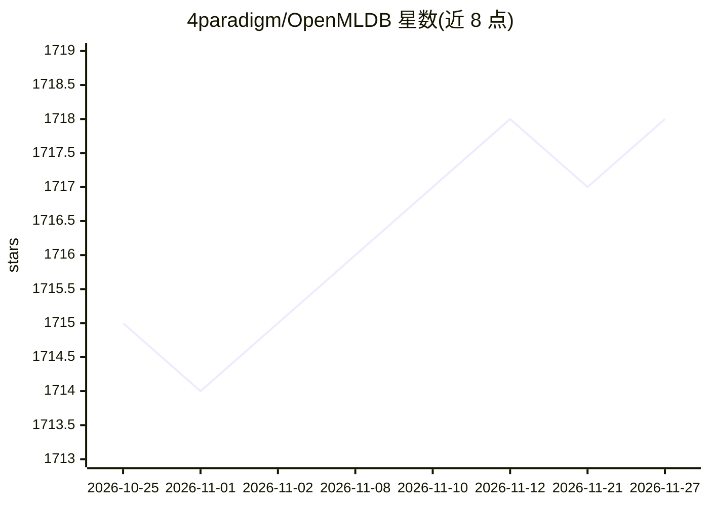

# 4paradigm/OpenMLDB

⭐ 1,718 · C++ · Apache-2.0 · 推送 2026-11-10 · [GitHub](https://github.com/4paradigm/OpenMLDB) · [官网](https://openmldb.ai) · 组织维护 · 中文 README

**面向 ML 团队的开源特征计算数据库，统一训练与推理特征**

OpenMLDB 是开源机器学习数据库，定位为 ML 应用的特征平台：用 SQL 定义特征，通过统一执行计划生成器桥接离线批量 SQL 引擎（基于定制 Spark 发行版）与实时 SQL 引擎，保证训练与推理特征一致性。宣称三步完成开发到部署：SQL 离线开发、一条命令在线部署、配置实时数据源。源自第四范式商业产品，README 称已在数百个企业应用中部署，并含可用于金融、IoT 的时序数据库能力。安装通过 GitHub release、中国镜像站或 Docker 镜像。

## 筛选速览

| 维度 | 判定 | 备注 |
|---|---|---|
| AI 角色 | `ai-ecosystem` | LLM/agent 周边工具 |
| 许可风险 | `permissive` | Apache-2.0 |
| 部署形态 | `self-host` | docker 或自建部署 |
| 模型依赖 | — | README 未给出锁定关系 |
| 硬件要求 | — | 无带数字的原话,不猜 |
| 安装摩擦 | `low` | 无编译、无系统依赖或容器化 |
| 成熟度 | — | 结构信号不足 |

## 能力要点

- 统一执行计划生成器保证训练与推理特征一致
- 实时 SQL 引擎针对时序数据优化，毫秒级产生实时特征
- SQL 作为统一语言并扩展 LAST JOIN、WINDOW UNION 语法
- 支持分布式存储计算、容灾恢复、高可用与水平扩展

## 适用场景

- 为实时个性化推荐和风控系统提供低延迟在线特征
- 把数据科学家的离线特征脚本低成本部署到线上推理
- 金融、IoT 场景中作为高效时序数据库使用

## 场景标签

`MLOps` `金融量化` · 领域:学习与行业

## 证据(README 行号)

> L32: ### OpenMLDB is an open-source machine learning database that provides a feature platform computing consistent feat
> L44: OpenMLDB is particularly designed as a feature platform for ML applications to accomplish the mission of **Developm
> L54: In order to achieve the goal of Development as Deployment, OpenMLDB is designed to provide consistent features for 

## 星数曲线

2026-10-25 1,715 → 2026-11-27 1,718（+3）

---
*卡片 v1 · prompt 1.4 · 生成 2026-11-24 · 置信度 high · 依据 README sha `372fd5908c00` · [字段定义](../../DATASET.md)*
