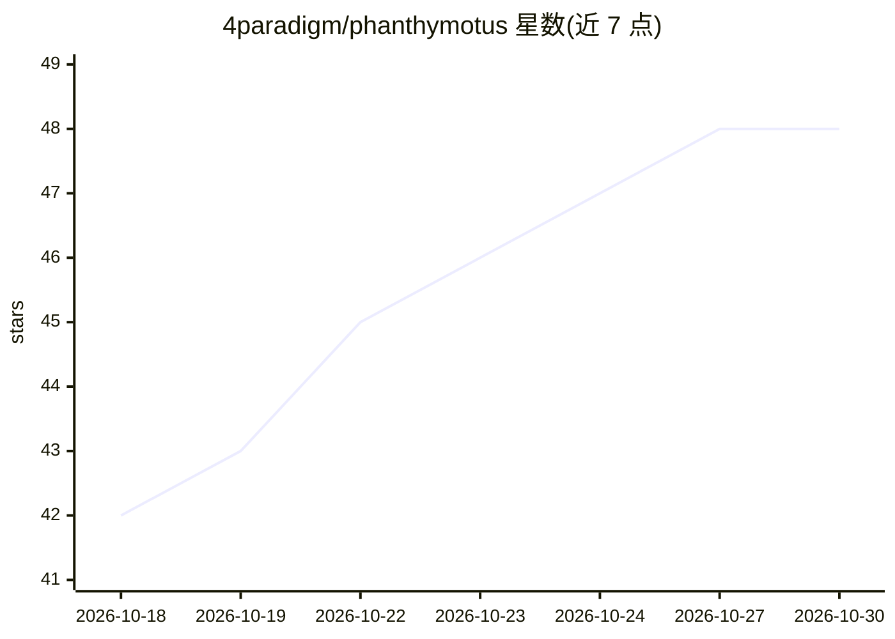

# 4paradigm/phanthymotus

⭐ 48 · Python · Apache-2.0 · 推送 2026-10-28 · [GitHub](https://github.com/4paradigm/phanthymotus) · [官网](https://motus.phanthy.com/) · 组织维护 · 中文 README

**给机器人开发者的具身智能 Agent 框架与平台（ROS2 基础）**

基于 ROS2 的开源具身 AI Agent 框架与平台，运行 sense→think→act 单循环：硬件驱动以 MCP server 形式接入，感知层提供 ASR/TTS/VLM 描述/人脸识别，Agent Loop 由事件驱动 LLM 多轮工具调用，ActuCore 作为执行模型卡宿主（VLA、导航、抓取，当前不随附模型卡）。提供拖拽式 Web 仪表盘、多机器人 peer 协作（Ed25519 身份、6 位配对码、mTLS，部分能力未实现）、DDS 回环隔离安全机制。一条 curl 命令安装，脚本自动装 Docker 并拉取镜像。驱动在独立仓库 phanthymotus-driver 维护。

## 筛选速览

| 维度 | 判定 | 备注 |
|---|---|---|
| AI 角色 | `ai-ecosystem` | LLM/agent 周边工具 |
| 许可风险 | `permissive` | Apache-2.0 |
| 部署形态 | `self-host` | docker 或自建部署 |
| 模型依赖 | — | README 未给出锁定关系 |
| 硬件要求 | — | 无带数字的原话,不猜 |
| 安装摩擦 | `low` | 无编译、无系统依赖或容器化 |
| 成熟度 | `idea` | |

## 能力要点

- 硬件驱动即 MCP server，四类工具（sensor/actuator/processor/resource）统一接入
- 事件驱动的 Agent Loop：LLM 推理 + 多轮工具调用 + 子代理与技能管理
- 多机器人 peer 协作：mDNS/云端/BLE 发现，Ed25519 身份与 mTLS 传输
- DDS 总线回环隔离与签名 HTTPS 状态同步的安全设计

## 适用场景

- 把传感器、LLM/VLM 与执行模型编排到同一画布驱动机器人
- 多台机器人在局域网或跨站点以 peer 身份协作
- 通过浏览器实时监控设备与 agent 决策流

## 场景标签

`Agent 框架` · 领域:Agent 开发

## 证据(README 行号)

> L5: **Give Embodied AI a Real Soul.** PhanthyMotus is a next-generation, open-source framework and platform for Embodied
> L40: - **Event-Driven Agent Loop** — LLM-powered reasoning with multi-turn tool calling, driven by real-time sensor even
> L42: - **Pluggable Perception** — Modular ASR/TTS stack with multi-instance support and local inference (Jetson)

## 星数曲线

2026-10-18 42 → 2026-10-30 48（+6）

---
*卡片 v1 · prompt 1.4 · 生成 2026-10-25 · 置信度 high · 依据 README sha `aa919fb658ba` · [字段定义](../../DATASET.md)*
