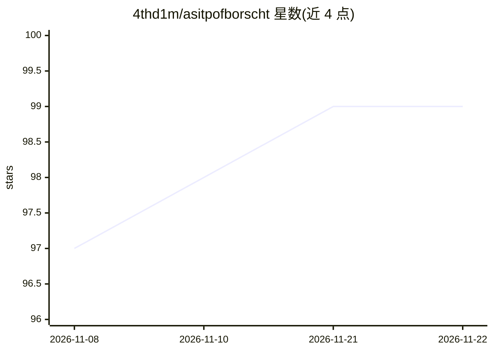

# 4thd1m/asitpofborscht

⭐ 99 · Python · NOASSERTION · 推送 2026-11-21 · [GitHub](https://github.com/4thd1m/asitpofborscht) · [官网](https://sitp.ai) · 个人维护

**深度学习教科书仓库与配套教学用框架 borscht**

托管 SITP 教科书源码与 `borscht` 教学 Deep Learning 框架的仓库，采用文学编程（literate programming）组织：./models 下按 Bigram 到 nanochat/nanoreasoner 的 12 个模型阅读顺序讲解神经网络架构，./borscht 下从 Python 张量逐步推进到 Rust、RISC-V、CUDA、Tensor Compiler 与推理引擎，讲解框架构建。运行各模块需本机具备 Python 与 Rust 工具链（通过 borscht/setup.sh 准备），并附研究博客系列。

## 筛选速览

| 维度 | 判定 | 备注 |
|---|---|---|
| AI 角色 | `ai-ecosystem` | LLM/agent 周边工具 |
| 许可风险 | `none` | NOASSERTION |
| 部署形态 | `None` |  |
| 模型依赖 | — | README 未给出锁定关系 |
| 硬件要求 | — | 无带数字的原话,不猜 |
| 安装摩擦 | `medium` | 含编译或系统依赖之一 |
| 成熟度 | — | 结构信号不足 |

## 能力要点

- 12 个神经网络模型的文学编程阅读路径（Bigram 到 Post-trained Transformer）
- 教学框架从 Python 张量逐步实现 Rust/CUDA GPU 内核与 Tensor Compiler、推理引擎
- 覆盖 GPU 架构演进（Volta→Ampere sm80→Hopper sm90）

## 适用场景

- 按阅读顺序自学深度学习模型与框架内部实现
- 通过阅读并运行源码理解 autograd 与 GPU 内核加速
- 跟进从 modded-nanogpt 到分布式训练的研究博客系列

## 场景标签

`教程课程` · 领域:学习与行业

## 证据(README 行号)

> L3: This repository hosts the https://sitp.ai textbook and the `borscht` teaching deep learning framework (`nanogpt` com
> L30: Ensure you have Python and Rust toolchains on your machine by running `borscht/setup.sh` in your shell.

## 星数曲线

2026-11-08 97 → 2026-11-22 99（+2）

---
*卡片 v1 · prompt 1.4 · 生成 2026-11-17 · 置信度 high · 依据 README sha `fbc0913e91f7` · [字段定义](../../DATASET.md)*
