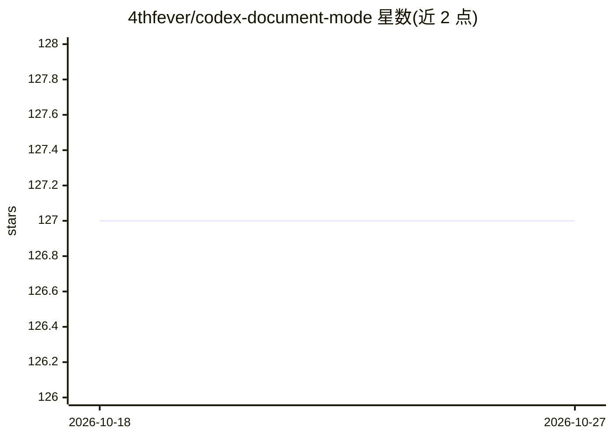

# 4thfever/codex-document-mode

⭐ 127 · JavaScript · MIT · 推送 2026-07-30 · [GitHub](https://github.com/4thfever/codex-document-mode) · 个人维护 · 中文 README

**给 Codex 桌面端用户的公文式回复与圈阅反馈注入工具**

通过本机 CDP 注入（不修改官方安装包、app.asar 或 WindowsApps）为 Codex 桌面端添加三类功能：回复侧呈现题头、称谓、正文、落款的公文格式；发送时临时附加文风约束提示使 LLM 回复偏向正式公文表达（不改写代码、命令、日志、JSON 及用户指定格式）；输入框左侧新增圈阅区域，画圈/画叉识别后以可编辑文字写入反馈。Windows 与 macOS 均提供版本，Windows 建议先运行本机预检，安装说明分见两系统文档。README 声明仅供娱乐与学习交流，非 OpenAI 官方产品。

## 筛选速览

| 维度 | 判定 | 备注 |
|---|---|---|
| AI 角色 | `ai-ecosystem` | LLM/agent 周边工具 |
| 许可风险 | `permissive` | MIT |
| 部署形态 | `None` |  |
| 模型依赖 | — | README 未给出锁定关系 |
| 硬件要求 | — | 无带数字的原话,不猜 |
| 安装摩擦 | `low` | 无编译、无系统依赖或容器化 |
| 成熟度 | `idea` | |

## 能力要点

- 回复侧公文格式呈现（题头/称谓/落款/公文式标题）
- 发送时临时附加公文文风约束，不改代码与命令等原始内容
- 画圈/画叉圈阅识别并以可编辑文字反馈，可自动发送
- 本机 CDP 注入，不修改官方安装包

## 适用场景

- 把 Codex 桌面端回复改为正式公文样式
- 用圈阅方式快速表达对回复的同意或不同意
- 以公文文风约束获得更正式书面的 LLM 回复

## 场景标签

`AI 写作` · 领域:内容生成

## 证据(README 行号)

> L5:  本机 CDP 注入，不改官方安装包。非 OpenAI 官方产品。
> L18: 通过公文的形式操作Codex，既提供了新式的Vibe体验，又强制LLM在通盘思考后，尽量清晰、正式、明确的表达观点和意见。

## 星数曲线

2026-10-18 127 → 2026-10-27 127（+0）

---
*卡片 v1 · prompt 1.4 · 生成 2026-10-23 · 置信度 mid · 依据 README sha `ed07b6c0f01a` · [字段定义](../../DATASET.md)*
