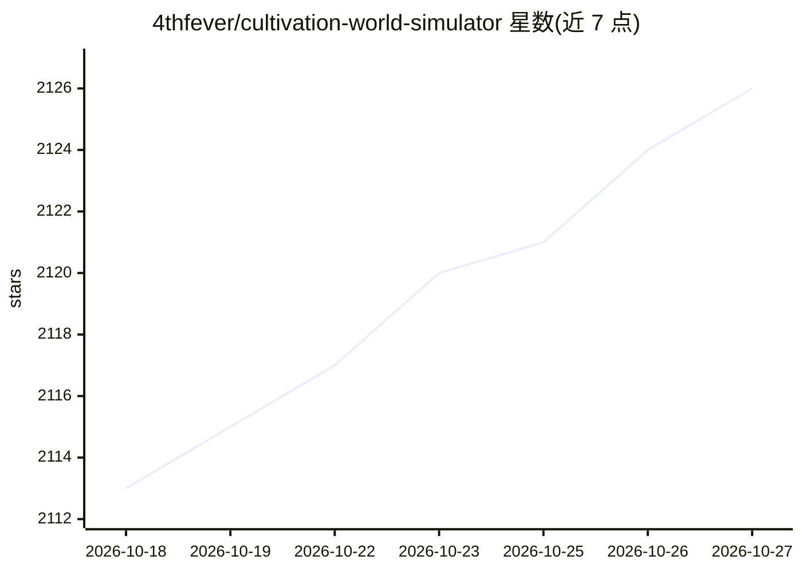

# 4thfever/cultivation-world-simulator

⭐ 2,126 · Python · NOASSERTION · 推送 2026-08-16 · [GitHub](https://github.com/4thfever/cultivation-world-simulator) · 个人维护 · 中文 README

**LLM 驱动全员 NPC 的修仙世界模拟器游戏**

AI 驱动的修仙世界模拟游戏：每个修士 NPC 是独立 LLM Agent，拥有性格、记忆、人际关系与长短期目标，可自由观测环境并决策；世界在灵根、境界、宗门、丹药等规则框架内运行，剧情由规则与 AI 共同推演涌现。玩家扮演'天道'，可观察世界演化并降下天劫、修改心灵等干预。技术栈为 Python/FastAPI 后端与 Vue/PixiJS 前端，提供 Epic Games Store 桌面版、Docker 部署与源码开发三种使用方式，需自行配置 LLM 模型服务（如 DeepSeek/MiniMax/Ollama）；另提供只读查询与受控写入的外部 API 供 agent 接入。

## 筛选速览

| 维度 | 判定 | 备注 |
|---|---|---|
| AI 角色 | `ai-native` | 本体是模型或模型工具 |
| 许可风险 | `none` | NOASSERTION |
| 部署形态 | `self-host` | docker 或自建部署 |
| 模型依赖 | local-ok | 支持本地模型 |
| 硬件要求 | — | 无带数字的原话,不猜 |
| 安装摩擦 | `low` | 无编译、无系统依赖或容器化 |
| 成熟度 | `idea` | |

## 能力要点

- 每个 NPC 为独立 LLM Agent，具备性格、记忆、目标与决策
- 规则系统（灵根/境界/宗门/丹药等）约束 AI 演化框架
- 提供 /api/v1/query 与 /api/v1/command 外部 API 供 agent/Claw 接入
- 支持 Epic 桌面版、Docker 部署与源码开发三种运行方式

## 适用场景

- 作为'天道'观察修仙世界自主演化并干预世界进程
- 通过外部 API 接入 agent 实现'观察-决策-干预'闭环游玩
- 基于源码做修仙世界模拟的二次开发与创作

## 场景标签

 · 领域:游戏/Agent 模拟

## 证据(README 行号)

> L31: 这是一个 **AI 驱动的修仙世界模拟器**。
> L37: - 🤖 **全员 AI 驱动**：每个 NPC 都独立基于LLM驱动，都有独立的性格、记忆、人际关系和行为逻辑。他们会根据即时局势做出决策，会有爱恨情仇，会结党营私，甚至会逆天改命。
> L320: - ✅ LLM驱动的NPC对话、思考、互动

## 星数曲线

2026-10-18 2,113 → 2026-10-27 2,126（+13）

---
*卡片 v1 · prompt 1.4 · 生成 2026-10-21 · 置信度 high · 依据 README sha `b2445c15158e` · [字段定义](../../DATASET.md)*
