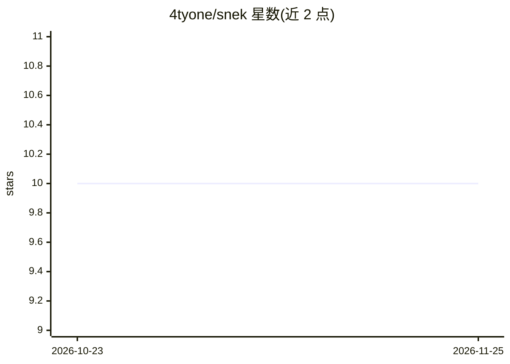

# 4tyone/snek

⭐ 10 · Rust · Apache-2.0 · 推送 2025-12-16 · [GitHub](https://github.com/4tyone/snek) · 个人维护

**可定制上下文的 AI 代码补全工具，支持 VS Code 与 Neovim**

Snek 是基于 LSP 的 AI tab 补全工具，运行于 VS Code 和 Neovim，核心机制是会话制上下文管理：用户通过 markdown 文件描述架构与约定、引用代码片段、按任务组织多个 session，这些上下文始终包含在补全请求中。补全由 Cerebras 推理服务生成，需配置 API key。另提供面向 Claude Code 等 CLI agent 的 slash 命令库（代码分析、git 操作、`/snek.fill` 代码生成流程）。支持 Rust、Python、JS/TS、Go、C/C++、Java、Lua。无遥测，本地处理上下文。

## 筛选速览

| 维度 | 判定 | 备注 |
|---|---|---|
| AI 角色 | `ai-native` | 本体是模型或模型工具 |
| 许可风险 | `permissive` | Apache-2.0 |
| 部署形态 | `None` |  |
| 模型依赖 | — | README 未给出锁定关系 |
| 硬件要求 | — | 无带数字的原话,不猜 |
| 安装摩擦 | `low` | 无编译、无系统依赖或容器化 |
| 成熟度 | — | 结构信号不足 |

## 能力要点

- 会话制上下文系统：markdown 约定文件与代码片段始终注入补全请求
- 基于 Cerebras 推理的补全（默认模型 qwen-3-235b-a22b-instruct-2507）
- 面向 CLI coding agent 的 slash 命令库，含 /snek.fill 标注式代码生成
- 支持 VS Code 与 Neovim，覆盖 8 种语言

## 适用场景

- 让补全遵循自己项目的架构约定与命名风格
- 不同任务/功能切换不同的补全上下文会话
- 用 @@snek 标注块让 agent 按规格逐个实现代码

## 场景标签

`代码生成` `编码 Agent` · 领域:编码与开发

## 证据(README 行号)

> L3: # Snek - AI tab-completion with customizable context
> L20: Snek gives you full control over your AI's context. Instead of hoping the AI figures out your codebase, you tell it
> L298: 5. **Cerebras generates completion** in <800ms

## 星数曲线

2026-10-23 10 → 2026-11-25 10（+0）

---
*卡片 v1 · prompt 1.4 · 生成 2026-11-20 · 置信度 high · 依据 README sha `29b7a891f528` · [字段定义](../../DATASET.md)*
