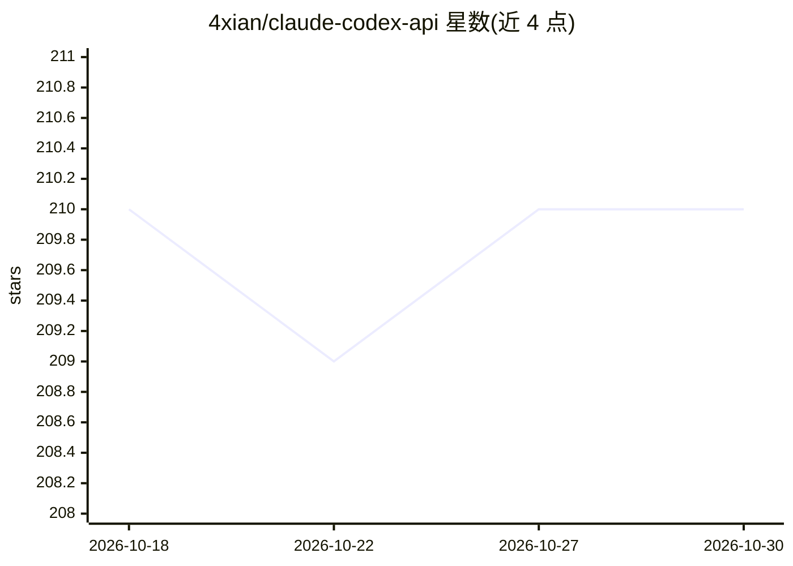

# 4xian/claude-codex-api

⭐ 210 · JavaScript · 推送 2026-06-16 · [GitHub](https://github.com/4xian/claude-codex-api) · 个人维护 · 中文 README

**Claude Code / Codex API 配置切换管理 CLI 工具**

面向 Claude Code 与 Codex CLI 用户的配置管理命令行工具：读取 JSON/JSON5/YAML/TOML 格式的自定义配置文件，一键在多个 API 中转站配置间切换，同时修改 settings.json 与系统环境变量；提供延迟测试（ping）、API 可用性测试（接口模拟或真实 CLI 两种方式）与按延迟自动择优切换；url/key/token/model 等字段支持数组多值并按索引搭配。限制：仅支持 Anthropic 格式配置。通过 npm 全局安装，要求 Node.js >= 18，支持 macOS/Linux/Windows。

## 筛选速览

| 维度 | 判定 | 备注 |
|---|---|---|
| AI 角色 | `ai-ecosystem` | LLM/agent 周边工具 |
| 许可风险 | `none` | — |
| 部署形态 | `library` | 以包/库形式分发 |
| 模型依赖 | — | README 未给出锁定关系 |
| 硬件要求 | — | 无带数字的原话,不猜 |
| 安装摩擦 | `low` | 无编译、无系统依赖或容器化 |
| 成熟度 | — | 结构信号不足 |

## 能力要点

- 一键切换多个 API 配置并同步修改 settings.json 与系统环境变量
- 延迟测试与 API 可用性测试（接口模拟/真实 CLI 两种方式）
- 按延迟自动择优切换，支持 ccapi auto && claude 组合命令
- url/key/token/model 等字段支持数组多值并按索引对齐搭配

## 适用场景

- 在多个 API 中转站配置间快速切换
- 启动 Claude Code 前自动选择延迟最低的可用线路
- 批量测试中转站 API 的连通性与可用性

## 场景标签

 · 领域:开发者工具/AI 客户端配置管理

## 证据(README 行号)

> L5: 一个Claude 和 Codex 配置管理工具，一键切换多个中转站API配置；
> L40: 初次使用需要设置Claude Code的settings.json 文件路径和自定义API配置文件路径：
> L74: 【本工具只提供快速切换环境变量的功能，因此只支持Anthropic格式的配置, 只要Claude Code能用就都可以】

## 星数曲线

2026-10-18 210 → 2026-10-30 210（+0）

---
*卡片 v1 · prompt 1.4 · 生成 2026-10-22 · 置信度 high · 依据 README sha `8fcd9d008a48` · [字段定义](../../DATASET.md)*
