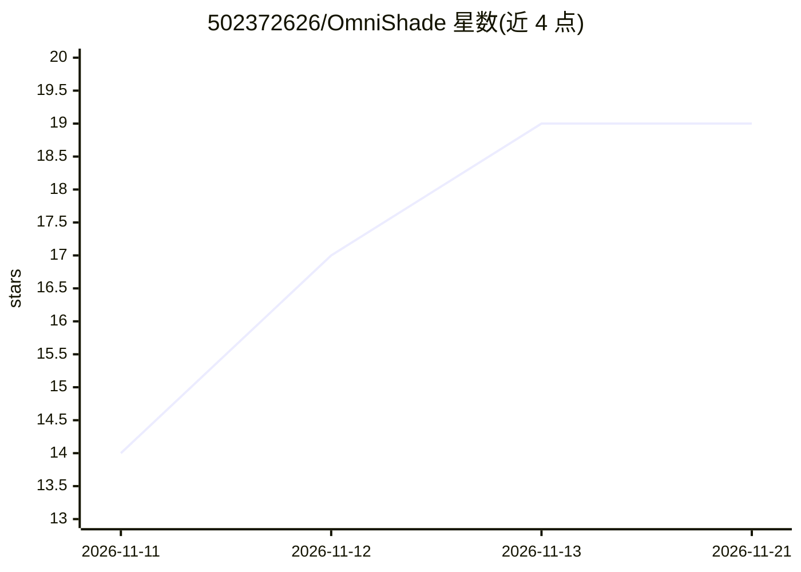

# 502372626/OmniShade

⭐ 19 · JavaScript · MIT · 推送 2026-11-11 · [GitHub](https://github.com/502372626/OmniShade) · [官网](https://omnishade.czyundun.cn) · 个人维护 · 中文 README

**Windows 本地 AI 作业台：对话直连 49 个本机工具能力**

Electron 桌面应用，在本地运行一条 MCP 工具桥，把 49 个本机能力接入 AI 对话，涵盖 Windows 命令执行、系统/进程管理、全盘文件操作、截屏与窗口枚举、CDP 驱动 Chrome、本地知识库检索与并行子代理分派。授权、工具桥与会话数据均落在本机，声明断网可用，无需填 API Key。Windows 下双击安装包安装并注册账号获得永久授权；仓库同时提供从源码构建的 npm 流程。

## 筛选速览

| 维度 | 判定 | 备注 |
|---|---|---|
| AI 角色 | `ai-native` | 本体是模型或模型工具 |
| 许可风险 | `permissive` | MIT |
| 部署形态 | `desktop` | 安装包/桌面程序 |
| 模型依赖 | — | README 未给出锁定关系 |
| 硬件要求 | — | 无带数字的原话,不猜 |
| 安装摩擦 | `low` | 无编译、无系统依赖或容器化 |
| 成熟度 | — | 结构信号不足 |

## 能力要点

- MCP 工具桥接入 49 个本机工具（命令执行/文件/桌面/浏览器/检索）
- 39 阶段作业链、任务池与并行子代理分派
- 零配置：不需要填 API Key、不需要配 MCP
- 安装包提供 GitHub 官方、两条加速线路与国内直链共四种下载线路并给出 SHA256

## 适用场景

- 用对话直接操作 Windows 命令、进程与文件
- 通过 CDP 控制本机 Chrome 完成网页操作
- 搭建本地知识库并做三路融合检索

## 场景标签

`AI 助手` `浏览器自动化` `知识库管理` · 领域:效率与自动化

## 证据(README 行号)

> L3: > 一个把「AI 对话」和「本机作业能力」焊在一起的桌面客户端。
> L14: OmniShade 不是又一个套壳聊天框。它在本地跑一条完整的**工具桥**，把 49 个本机能力直接接进对话：
> L73: ├── bridge.js         工具桥 :9431（MCP，49 个工具）

## 星数曲线

2026-11-11 14 → 2026-11-21 19（+5）

---
*卡片 v1 · prompt 1.4 · 生成 2026-11-18 · 置信度 high · 依据 README sha `d10036b45dcf` · [字段定义](../../DATASET.md)*
