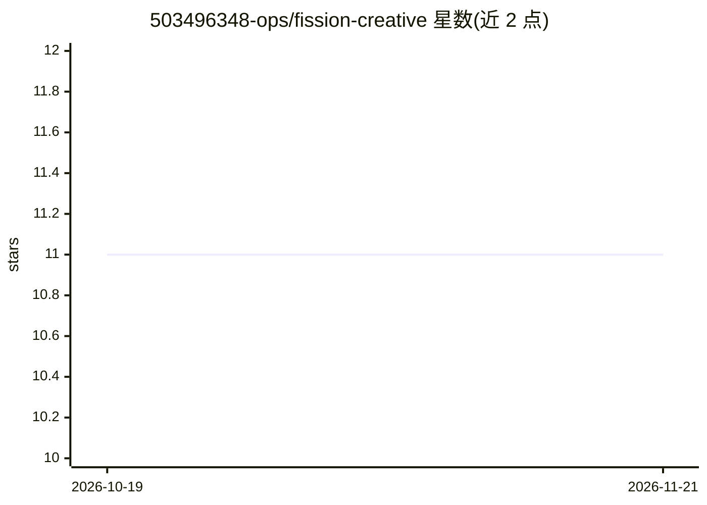

# 503496348-ops/fission-creative

⭐ 11 · Python · GPL-3.0 · 推送 2026-07-29 · [GitHub](https://github.com/503496348-ops/fission-creative) · [官网](https://503496348-ops.github.io/atomcollide-product-matrix/) · 组织维护 · 中文 README

**长篇网文AI辅助创作系统：管理设定与伏笔防遗忘**

基于 lingfengQAQ/webnovel-writer 改造、适配 Hermes Agent 平台的网文创作技能包。通过合同驱动的事实管理、结构化大纲、六维审查与润色流程组织写作，提供 7 个子命令：初始化书籍、卷纲规划、章节生成流水线、审查、状态查询、经验记录与可视化面板。声明支持 200 万字量级连载与 37 种中文网文题材，核心功能不依赖向量检索，Embedding/Rerank 为可选配置。需要 Hermes Agent 运行环境与 Python 3.10+。

## 筛选速览

| 维度 | 判定 | 备注 |
|---|---|---|
| AI 角色 | `ai-native` | 本体是模型或模型工具 |
| 许可风险 | `viral` | GPL-3.0 |
| 部署形态 | `library` | 以包/库形式分发 |
| 模型依赖 | — | README 未给出锁定关系 |
| 硬件要求 | — | 无带数字的原话,不猜 |
| 安装摩擦 | `low` | 无编译、无系统依赖或容器化 |
| 成熟度 | — | 结构信号不足 |

## 能力要点

- 7 个子命令覆盖初始化、规划、写作、审查、查询、记录与面板
- 六维审查（爽点/一致性/节奏/OOC/连贯性/追读力）并输出报告
- 合同驱动的事实管理与防幻觉三定律机制
- 37 种中文网文题材模板

## 适用场景

- 用 AI Agent 连载百万字级网文并保持设定一致
- 对生成的章节做批量质量审查并按建议修改
- 浏览项目状态、实体图谱与章节内容面板

## 场景标签

`AI 写作` · 领域:内容生成

## 证据(README 行号)

> L40: > 基于 lingfengQAQ/webnovel-writer 改造，适配 Hermes Agent 平台。
> L85: /webnovel-write 1     # 写第1章：上下文组装→起草→审查→润色→事实提取→备份
> L172: A: 需要 Hermes Agent 运行环境。依赖 Python 3.10+，安装 `pip install -r requirements.txt`。

## 星数曲线

2026-10-19 11 → 2026-11-21 11（+0）

---
*卡片 v1 · prompt 1.4 · 生成 2026-11-19 · 置信度 mid · 依据 README sha `73788a34fb59` · [字段定义](../../DATASET.md)*
