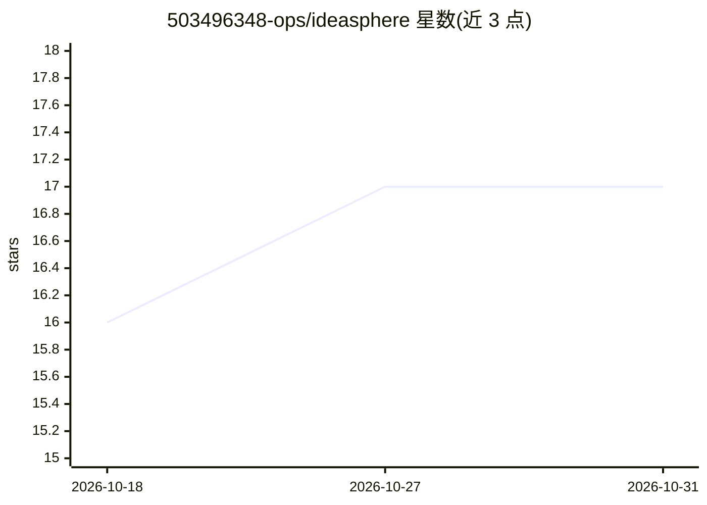

# 503496348-ops/ideasphere

⭐ 17 · Python · MIT · 推送 2026-07-28 · [GitHub](https://github.com/503496348-ops/ideasphere) · 组织维护 · 中文 README

**自媒体视频一站式剪辑技能包：供 Agent 执行视频处理流水线**

灵感象限（Ideasphere）是 Hermes Agent 的视频编辑技能包，以 Python 脚本与 SKILL.md 定义形式提供。输入本地素材或在线 URL 后执行流水线：yt-dlp 下载（1000+ 平台）、auto-editor 去静音、Faster Whisper 语音转字幕、LLM 纠错与上下文感知翻译、ffmpeg 字幕烧录、Edge TTS/OpenAI TTS 配音、多平台比例适配渲染与导出；支持 Manifest 断点续跑。LLM 需为兼容 OpenAI API 规范的服务（MiniMax/OpenAI/DeepSeek/通义千问等）。附带 doctor 诊断、smoke 冒烟与产品收敛门禁脚本。

## 筛选速览

| 维度 | 判定 | 备注 |
|---|---|---|
| AI 角色 | `ai-ecosystem` | LLM/agent 周边工具 |
| 许可风险 | `permissive` | MIT |
| 部署形态 | `None` |  |
| 模型依赖 | — | README 未给出锁定关系 |
| 硬件要求 | — | 无带数字的原话,不猜 |
| 安装摩擦 | `medium` | 含编译或系统依赖之一 |
| 成熟度 | — | 结构信号不足 |

## 能力要点

- 下载→去静音→转字幕→LLM纠错→翻译→烧录→TTS配音→多平台导出的完整流水线
- 支持 YouTube/B站/TikTok/抖音 等 1000+ 平台在线下载
- Edge TTS 免费 300+ 音色，语速自动对齐字幕时间轴
- Manifest 断点续跑与抖音/YouTube/小红书等多平台比例预设

## 适用场景

- 自媒体创作者批量将长视频剪成带双语字幕的多平台版本
- 为 Agent 接入自动化视频剪辑与配音能力
- 下载在线视频并生成翻译配音后的平台适配版本

## 场景标签

`语音合成` `语音识别` `图像视频处理` · 领域:内容生成

## 证据(README 行号)

> L46: 灵感象限是 Hermes Agent 的视频编辑技能包，输入本地素材或在线 URL，自动完成完整的视频处理流水线。
> L49: 在线下载(可选) → 去静音剪辑 → 语音转字幕 → LLM纠错 → 字幕翻译 → 双语字幕 → 字幕烧录 → TTS配音 → 平台适配渲染 → 多平台导出

## 星数曲线

2026-10-18 16 → 2026-10-31 17（+1）

---
*卡片 v1 · prompt 1.4 · 生成 2026-10-30 · 置信度 high · 依据 README sha `b40d4374c21f` · [字段定义](../../DATASET.md)*
