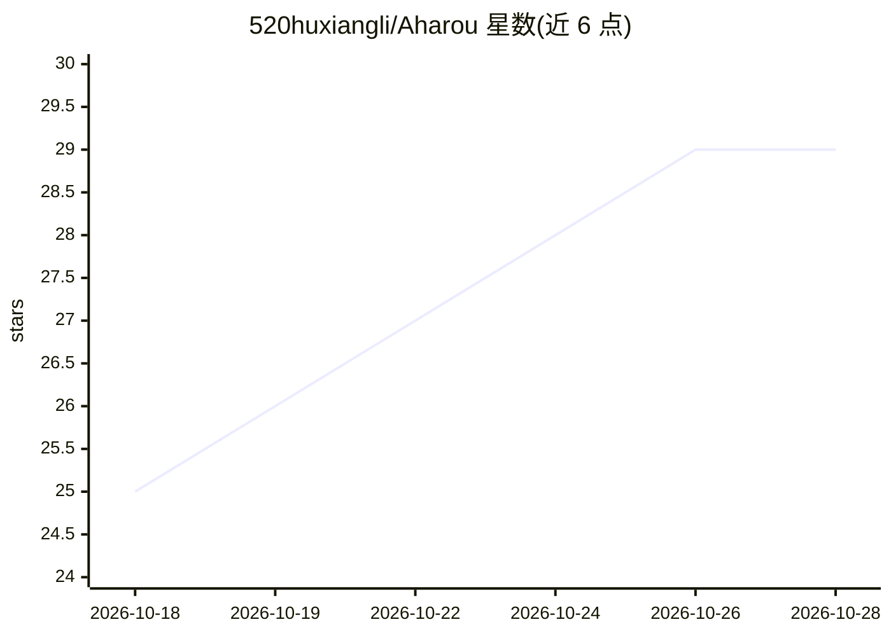

# 520huxiangli/Aharou

⭐ 29 · Kotlin · GPL-3.0 · 推送 2026-10-28 · [GitHub](https://github.com/520huxiangli/Aharou) · 个人维护 · 中文 README

**手机上的 AI 助手与 Coding Agent，内置 Linux 环境**

Android 平台的 AI 助手与 Coding Agent 应用，以 Kotlin/Jetpack Compose 编写。内置 Alpine（PRoot）容器与多标签终端，Agent 可读写文件、执行命令、跑构建，执行后端可切换到远程 SSH；另有浏览器面板、影子屏（无头虚拟显示屏）、Shizuku 系统层执行、MCP 与技能等能力。不内置模型，密钥与端点由用户自行配置，支持 Android 8.0+ 且无需 root，通过 Releases 页面下载 APK 安装。项目基于 AiCode 改造，GPL-3.0 开源。

## 筛选速览

| 维度 | 判定 | 备注 |
|---|---|---|
| AI 角色 | `ai-native` | 本体是模型或模型工具 |
| 许可风险 | `viral` | GPL-3.0 |
| 部署形态 | `None` |  |
| 模型依赖 | — | README 未给出锁定关系 |
| 硬件要求 | — | 无带数字的原话,不猜 |
| 安装摩擦 | `low` | 无编译、无系统依赖或容器化 |
| 成熟度 | — | 结构信号不足 |

## 能力要点

- 内置 Alpine（PRoot）Linux 容器与多标签终端，Agent 可执行命令与构建
- 影子屏：无头虚拟显示屏中运行、截图、操作 App
- 多供应商/多模型接入，不内置模型、不绑定供应商
- Shizuku 系统层命令执行与配置写入确认/审计/回滚机制

## 适用场景

- 在手机上使用 AI 助手与 Coding Agent 完成编码任务
- 通过内置 Linux 终端在移动端执行命令与构建
- 让 Agent 在不打扰前台的情况下于影子屏操作应用

## 场景标签

`编码 Agent` `AI 助手` `GUI 自动化` · 领域:效率与自动化

## 证据(README 行号)

> L3:  手机上的 AI 助手 · Coding Agent · 内置 Linux 环境
> L23: Aharou 把一套完整的 AI 助手与 Linux 环境装进手机：内置 Alpine 容器与多标签终端，Agent 能读写文件、执行命令、跑构建；也可以把执行后端切到远程 SSH。所有能力在本机完成，不用电脑，也不用自己搭环境。
> L27: - 🗨️ **AI 对话** — 多供应商 / 多模型，Markdown、图片、思考过程展示

## 星数曲线

2026-10-18 25 → 2026-10-28 29（+4）

---
*卡片 v1 · prompt 1.4 · 生成 2026-10-26 · 置信度 high · 依据 README sha `f0f6db13cdbb` · [字段定义](../../DATASET.md)*
