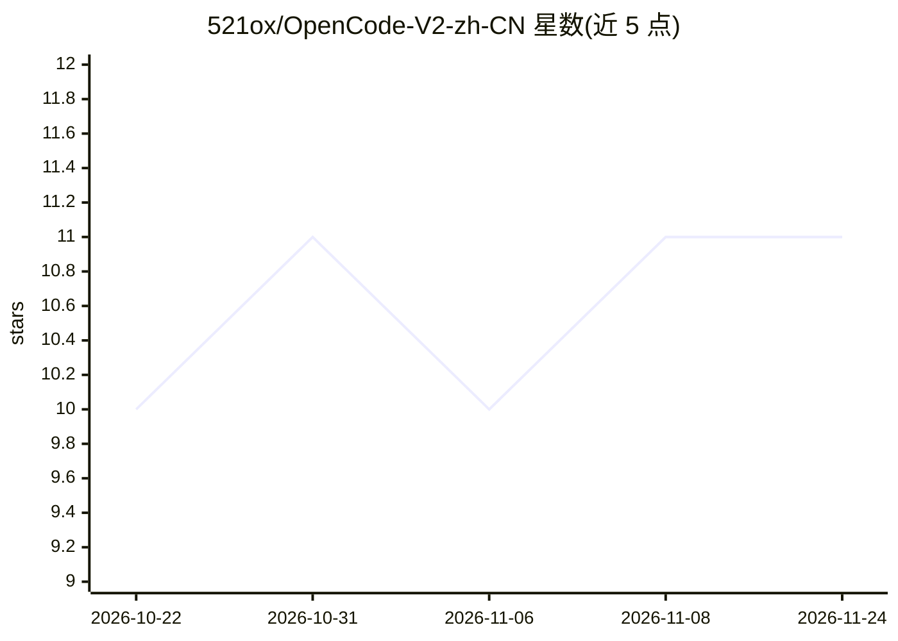

# 521ox/OpenCode-V2-zh-CN

⭐ 11 · TypeScript · MIT · 推送 2026-11-21 · [GitHub](https://github.com/521ox/OpenCode-V2-zh-CN) · [官网](https://github.com/521ox/OpenCode-V2-zh-CN#readme) · 个人维护 · 中文 README

**OpenCode V2 的简体中文社区汉化版终端编程代理**

由社区独立维护的 OpenCode 分支，非官方发行：TUI/Mini/`opencode run` 默认以简体中文启动，可切换英文，仅翻译界面文本，模型回复与协议数据保持不变。在官方 2.3.0 源码基础上加入受控执行的原生程序（direct_exec/environment_tools）、父子会话共享的工作记忆区、子代理会话点击跳转，并支持 OpenAI/xAI Responses 路由上的托管搜索。提供 Windows/Linux/macOS x64 与 ARM64 的未签名 CLI 预发布包，也可用 Bun+Node 从源码构建；CI 仅覆盖部分检查。

## 筛选速览

| 维度 | 判定 | 备注 |
|---|---|---|
| AI 角色 | `ai-ecosystem` | LLM/agent 周边工具 |
| 许可风险 | `permissive` | MIT |
| 部署形态 | `desktop` | 安装包/桌面程序 |
| 模型依赖 | — | README 未给出锁定关系 |
| 硬件要求 | — | 无带数字的原话,不猜 |
| 安装摩擦 | `low` | 无编译、无系统依赖或容器化 |
| 成熟度 | — | 结构信号不足 |

## 能力要点

- TUI/Mini/`opencode run` 简体中文界面，可切英文，仅翻译界面文本
- direct_exec 按目录条目 ID 受控执行已验证的原生 EXE/COM
- 父会话与子会话共享一个受保护的工作记忆区
- 提供三系统 x64/ARM64 CLI 包（内嵌 WebUI，非 Electron 安装器）

## 适用场景

- 在终端以简体中文界面使用 OpenCode 编程代理
- 需要从源码自行构建并定制 OpenCode CLI
- 管理父子代理会话并保留共享工作笔记

## 场景标签

`编码 Agent` · 领域:编码与开发

## 证据(README 行号)

> L5: This community-maintained edition of OpenCode starts the terminal interface in Simplified Chinese. Switch to English
> L17: |Chinese / English UI|Use the TUI, Mini and `opencode run` in Simplified Chinese, or choose English. Only interface
> L21: |Hosted search|Use native search on supported OpenAI or xAI Responses routes when effective permissions, model capa

## 星数曲线

2026-10-22 10 → 2026-11-24 11（+1）

---
*卡片 v1 · prompt 1.4 · 生成 2026-11-19 · 置信度 high · 依据 README sha `e3e3f27b1f4b` · [字段定义](../../DATASET.md)*
