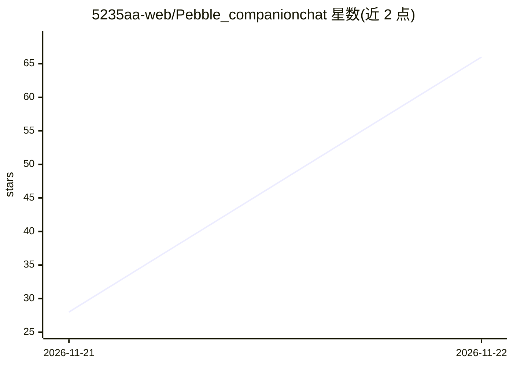

# 5235aa-web/Pebble_companionchat

⭐ 66 · Python · Apache-2.0 · 推送 2026-11-21 · [GitHub](https://github.com/5235aa-web/Pebble_companionchat) · 个人维护 · 中文 README

**本地优先的 AI 角色扮演伴侣聊天应用：文字、语音、图像一体的桌面工作台**

基于 FastAPI + SQLite + WebSockets 后端与 Vue 3 前端（可打包为 Tauri 2 桌面应用）的 AI 伴侣聊天工作台。功能覆盖单角色多会话聊天、最多 3 角色的群聊房间、SillyTavern PNG/JSON 角色卡导入导出、分场景剧本模式、基于 BM25 的免嵌入长期记忆检索，以及 ASR→LLM→TTS 的级联流式语音通话。LLM/TTS/ASR/绘图四类能力均可替换为本地引擎（llama.cpp GGUF、audio.cpp）或云服务。数据默认持久化在本地 ~/.pebblecompanion。

## 筛选速览

| 维度 | 判定 | 备注 |
|---|---|---|
| AI 角色 | `ai-native` | 本体是模型或模型工具 |
| 许可风险 | `permissive` | Apache-2.0 |
| 部署形态 | `library` | 以包/库形式分发 |
| 模型依赖 | local-ok | 支持本地模型 |
| 硬件要求 | — | 无带数字的原话,不猜 |
| 安装摩擦 | `low` | 无编译、无系统依赖或容器化 |
| 成熟度 | — | 结构信号不足 |

## 能力要点

- 多角色群聊房间（≤3 伴侣）与 @点名的舞台调度、接力回合
- SillyTavern PNG/JSON 角色卡生态兼容与内置编辑器
- BM25 免嵌入长期记忆检索，无需向量库与额外模型下载
- ASR→LLM→TTS 级联语音通话，Silero VAD 可打断

## 适用场景

- 在本地或云端模型上运行角色卡对话与伴侣聊天
- 组织多角色群聊或按剧本分场景推进的故事演绎
- 与角色进行流式语音通话
- 用本地 ComfyUI 工作流为聊天场景生成插图

## 场景标签

`聊天机器人` `语音 Agent` `图像生成` · 领域:对话与助手

## 证据(README 行号)

> L15: **Pebble Companion Chat (`P.C.C`)** is a desktop and web AI companion workspace driven by text, voice, and generate
> L66: |**LLM Chat**|`llama.cpp` (`llama-server` with GGUF, `mmproj` vision & MTP), Ollama, LM Studio, any local OpenAI-co
> L52: - **Cascaded Voice Loop**: The browser captures PCM through an AudioWorklet and streams it over WebSocket. The back

## 星数曲线

2026-11-21 28 → 2026-11-22 66（+38）

---
*卡片 v1 · prompt 1.4 · 生成 2026-11-21 · 置信度 high · 依据 README sha `7f6b5387b73d` · [字段定义](../../DATASET.md)*
