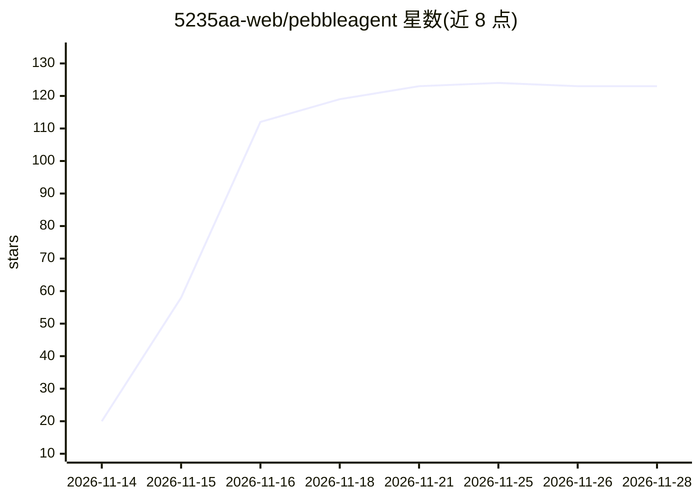

# 5235aa-web/pebbleagent

⭐ 123 · Python · AGPL-3.0 · 推送 2026-11-22 · [GitHub](https://github.com/5235aa-web/pebbleagent) · 个人维护 · 中文 README

**给开发者的桌面 AI agent：带工具、技能、MCP 与跨会话记忆**

基于 Tauri 2 + Vue 3 + Python 后端的桌面 AI agent，通过 WebSocket JSON-RPC 与网关通信。核心机制包括：将仓库索引为章节化代码知识库并随项目同步、本地 SQLite 经验账本跨会话记住用户纠正与偏好（规则匹配而非额外模型调用）、写前快照与回滚、三级权限模式与防篡改审计日志、MCP 服务器按项目审批安装（sha256 校验）、按模型峰值/低谷分档的实时成本跟踪。桌面 shell 仅 Windows 可构建，macOS 仅支持 web 模式，Linux 未测试。

## 筛选速览

| 维度 | 判定 | 备注 |
|---|---|---|
| AI 角色 | `ai-native` | 本体是模型或模型工具 |
| 许可风险 | `viral` | AGPL-3.0 |
| 部署形态 | `desktop` | 安装包/桌面程序 |
| 模型依赖 | — | README 未给出锁定关系 |
| 硬件要求 | — | 无带数字的原话,不猜 |
| 安装摩擦 | `low` | 无编译、无系统依赖或容器化 |
| 成熟度 | — | 结构信号不足 |

## 能力要点

- 代码知识库：索引仓库、对照源码校验并保持同步
- 跨会话经验账本：SQLite 存储、全文相关性召回、自动淘汰过期条目
- 权限与审计：tool:pattern 规则、路径白名单、链式校验和审计日志
- HTML 沙箱预览与反馈桥：点击元素留注释让 agent 迭代

## 适用场景

- 让 AI agent 直接在自己的仓库里读代码、改文件并可回滚
- 通过 MCP 面板按项目安装和审批外部服务器
- 跟踪与不同 LLM 提供商对话的实时 token 成本
- 让 agent 生成 HTML 页面并通过批注迭代设计

## 场景标签

`编码 Agent` `Agent 记忆` · 领域:Agent 开发

## 证据(README 行号)

> L3: **A light,extensible desktop AI agent with tools, skills, MCP servers, a self-maintained code knowledge base, and cr
> L23: - **Skills and MCP servers.** Two bundled skills (`ckb` and `frontend-design`) load on demand; MCP servers over std

## 星数曲线

2026-11-14 20 → 2026-11-28 123（+103）

---
*卡片 v1 · prompt 1.4 · 生成 2026-11-28 · 置信度 mid · 依据 README sha `1db20536193a` · [字段定义](../../DATASET.md)*
