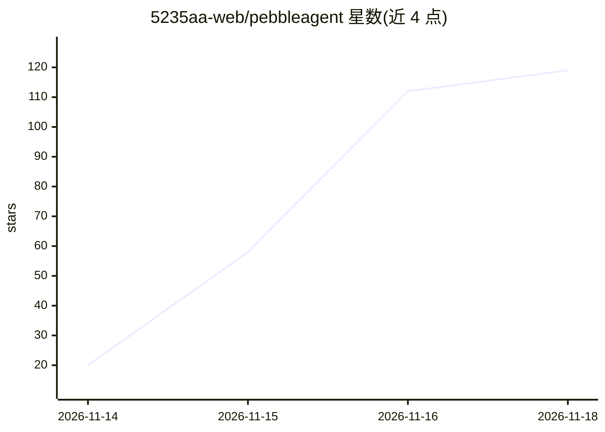

# 5235aa-web/pebbleagent

⭐ 119 · Python · AGPL-3.0 · 推送 2026-11-17 · [GitHub](https://github.com/5235aa-web/pebbleagent) · 个人维护 · 中文 README

**带工具与 MCP 的轻量桌面 AI 编程代理**

面向个人开发者的桌面 AI 编程代理：以 Vue 3 + Tauri 2 桌面壳与 Python 后端（WebSocket JSON-RPC）组成。功能包括将仓库索引为分章知识库并随项目同步、基于规则的跨会话经验账本（SQLite）、写入前快照与回滚、三档权限模式与防篡改审计日志、50 个内置技能与经 sha256 校验的 MCP 服务器管理、实时成本追踪（含中国法定节假日峰谷计价）与 HTML 沙盒预览反馈。桌面壳仅支持 Windows 构建，macOS 以 Web 模式运行，Linux 未测试。

## 筛选速览

| 维度 | 判定 | 备注 |
|---|---|---|
| AI 角色 | `ai-native` | 本体是模型或模型工具 |
| 许可风险 | `viral` | AGPL-3.0 |
| 部署形态 | `desktop` | 安装包/桌面程序 |
| 模型依赖 | — | README 未给出锁定关系 |
| 硬件要求 | — | 无带数字的原话,不猜 |
| 安装摩擦 | `low` | 无编译、无系统依赖或容器化 |
| 成熟度 | — | 结构信号不足 |

## 能力要点

- 仓库索引为自维护代码知识库并随项目同步
- 跨会话经验账本按规则捕获与召回，不额外调用模型
- 每次写入前快照，支持单文件或整变更集回滚
- 三档权限模式 + 规则集 + 链式校验审计日志

## 适用场景

- 日常轻量编码时让 agent 代为读写文件并回滚改动
- 通过对话安装技能与 MCP 服务器扩展 agent 能力
- 在受控权限与审计下让 agent 操作代码库

## 场景标签

`编码 Agent` · 领域:编码与开发

## 证据(README 行号)

> L3: **A light,extensible desktop AI agent with tools, skills, MCP servers, a self-maintained code knowledge base, and cr
> L19: - **Code Knowledge Base (CKB).** The agent indexes your repository into a chaptered knowledge base, verifies it aga
> L26: - **Streaming agent chat with full execution visibility.** Reasoning, tool calls, file changes, and results unfold 

## 星数曲线

2026-11-14 20 → 2026-11-18 119（+99）

---
*卡片 v1 · prompt 1.4 · 生成 2026-11-17 · 置信度 mid · 依据 README sha `d5e99942261c` · [字段定义](../../DATASET.md)*
