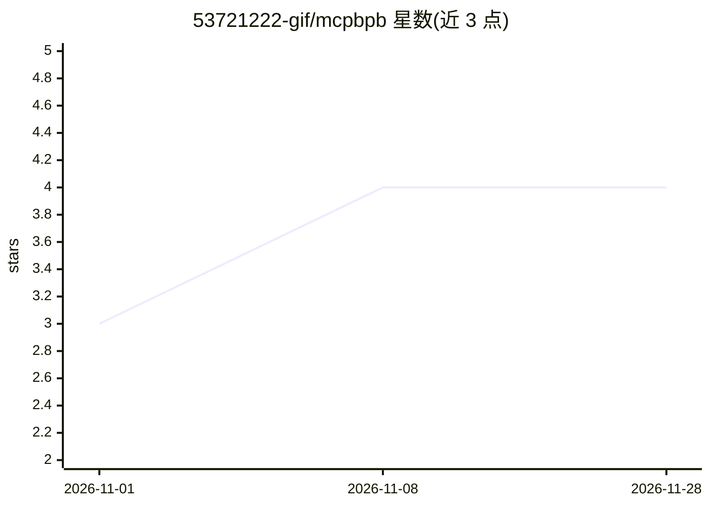

# 53721222-gif/mcpbpb

⭐ 4 · GDScript · MIT · 推送 2026-10-31 · [GitHub](https://github.com/53721222-gif/mcpbpb) · 个人维护 · 中文 README

**把 Backpack Battles 状态与操作暴露给 LLM 的本地 MCP 服务**

在《背包乱斗》游戏进程内挂载 Godot autoload bridge（TCP 127.0.0.1:8765，newline-delimited JSON），由 Python 侧 MCP stdio 服务对外提供约 30 个工具：读取职业、回合、金币、商店、背包摆盘、储物箱等状态，执行购买、刷新、编辑、摆放、旋转、宝石镶嵌、开战与生存模式选择等操作。通过 Godot override.cfg 注册 autoload，不改 pck、不注入 DLL，游戏更新后重新 install 即可；需 Windows 10/11、已购 Steam 版游戏且游戏正在运行。

## 筛选速览

| 维度 | 判定 | 备注 |
|---|---|---|
| AI 角色 | `ai-ecosystem` | LLM/agent 周边工具 |
| 许可风险 | `permissive` | MIT |
| 部署形态 | `desktop` | 安装包/桌面程序 |
| 模型依赖 | — | README 未给出锁定关系 |
| 硬件要求 | — | 无带数字的原话,不猜 |
| 安装摩擦 | `low` | 无编译、无系统依赖或容器化 |
| 成熟度 | — | 结构信号不足 |

## 能力要点

- 30+ 工具覆盖状态读取、购买、商店保留、背包编辑/摆放/旋转、宝石镶嵌与战斗流程
- 不改 pck：借助 Godot 3.6 override.cfg 注册 autoload，保留完整性校验
- 支持 Claude Desktop、Cursor/Cline 等 stdio MCP 客户端，并提供可选 HTTP API
- 战斗期返回摘要状态以避免游戏崩溃；自带 install/doctor/health/uninstall CLI

## 适用场景

- 让接入 MCP 的 LLM 代玩《背包乱斗》，读取商店与背包并执行购买摆放
- 用脚本或 Agent 框架通过 HTTP API 自动化开局与操作
- 排查游戏 bridge 连接与状态读取问题（doctor/health 命令）

## 场景标签

 · 领域:游戏/LLM 工具接入

## 证据(README 行号)

> L3: > 类似 **MCPTheSpire** 的《背包乱斗 / Backpack Battles》本地 MCP 服务：
> L4: > 在游戏内挂一个轻量 bridge，把**职业、回合、重试次数、金币、商店物品与价格、刷新费、背包摆盘、储物箱**暴露给大模型，并开放**购买、刷新、编辑背包/物品、摆放、旋转、开战**等操作。
> L17: - 游戏内 bridge 只监听 `127.0.0.1:8765`；Python 侧提供 MCP stdio 服务（可选 HTTP API）。

## 星数曲线

2026-11-01 3 → 2026-11-28 4（+1）

---
*卡片 v1 · prompt 1.4 · 生成 2026-11-21 · 置信度 high · 依据 README sha `75d3bf5973f6` · [字段定义](../../DATASET.md)*
