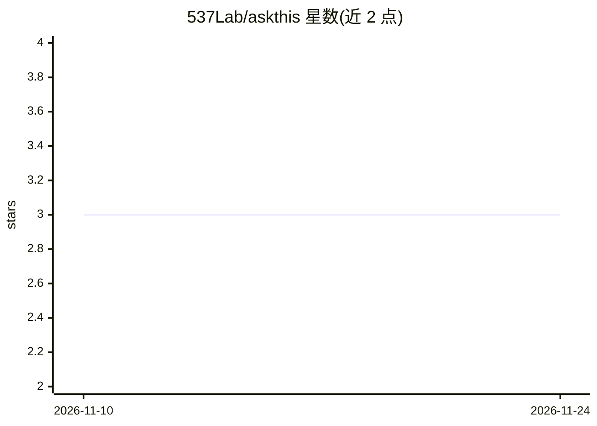

# 537Lab/askthis

⭐ — · [GitHub]() · 组织维护 · 中文 README

**给桌面用户一个快捷键唤起的 AI 速查卡片**

基于 Electron 的桌面速查工具：选中文字后按全局快捷键即可在光标旁唤出卡片提问，或无选区时直接输入；支持流式输出、追问、重新生成、本机历史、中英界面与深浅主题。自备 API 密钥接入多家云端服务商，也可连接 Ollama / LM Studio 本地模型。无注册、无遥测，密钥使用系统安全存储加密。能力边界：仅处理文字，不含 OCR；Linux 尚未真机验证，Wayland 下选区捕获受限。

## 筛选速览

| 维度 | 判定 | 备注 |
|---|---|---|
| AI 角色 | `ai-native` | 本体是模型或模型工具 |
| 许可风险 | `permissive` | — |
| 部署形态 | `desktop` | 安装包/桌面程序 |
| 模型依赖 | local-ok | 支持本地模型 |
| 硬件要求 | — | 无带数字的原话,不猜 |
| 安装摩擦 | `low` | 无编译、无系统依赖或容器化 |
| 成熟度 | — | 结构信号不足 |

## 能力要点

- 全局快捷键选中即问，光标旁弹出速查卡片并支持追问
- 多服务商接入及自定义 OpenAI / Anthropic 兼容端点，支持推理强度档位
- 无遥测、密钥系统安全存储、历史记录保存在本机
- 提供速查、翻译、代码解释、总结、润色等预设提示词

## 适用场景

- 阅读文档时选中术语即时解释或翻译
- 看代码时选中片段请求解释
- 不打断当前窗口随手向 AI 提问

## 场景标签

`AI 助手` · 领域:对话与助手

## 证据(README 行号)

> L3: > 选中就问，没选中就直接写。—— 桌面上的轻量 AI 速查卡片。
> L95: 支持 OpenAI、Anthropic、DeepSeek、Google Gemini、OpenRouter、Moonshot（Kimi）、智谱 GLM、硅基流动、xAI、Ollama / LM Studio，以及自定义 OpenA

## 星数曲线

2026-11-10 3 → 2026-11-24 3（+0）

---
*卡片 v1 · prompt 1.4 · 生成 2026-11-22 · 置信度 high · 依据 README sha `e087d9c9a919` · [字段定义](../../DATASET.md)*
