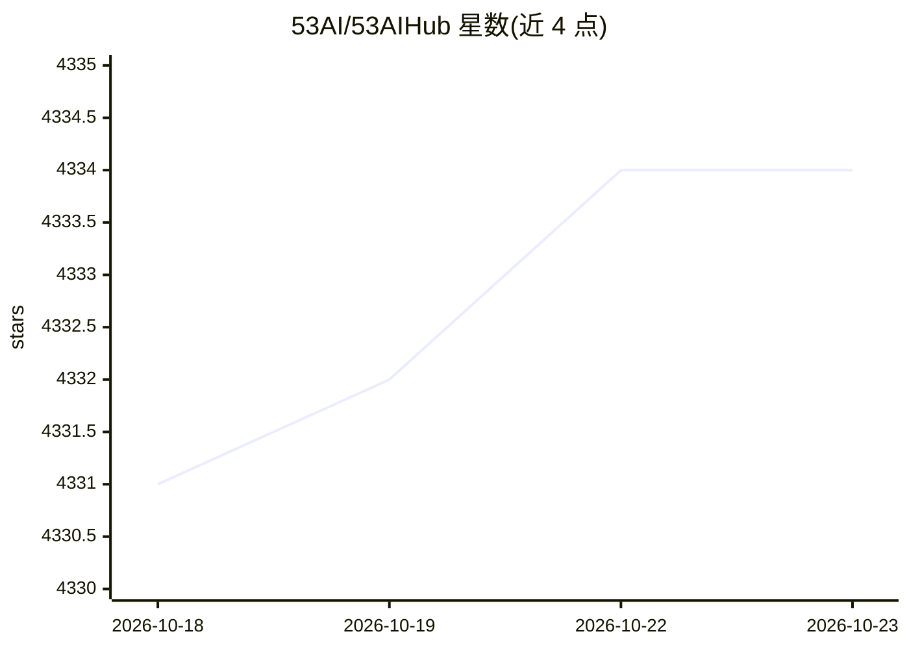

# 53AI/53AIHub

⭐ 4,334 · Go · NOASSERTION · 推送 2026-10-09 · [GitHub](https://github.com/53AI/53AIHub) · [官网](https://hub.53ai.com) · 组织维护 · 中文 README

**开源 AI 门户与知识库：企业统一发布管理 Agent、提示词与工具**

由 53AI 公司维护的开源 AI 门户：面向需要统一入口运营 AI 能力的企业与开发者，提供 AI agent、提示词、AI 工具的全生命周期管理（发布、分组、排序、权限配置），支持 Coze、Dify、FastGPT、RAGFlow、53AI Studio 平台接入及阿里云、腾讯云、百度云集成。含注册用户/内部用户运营、企业微信/钉钉/飞书 SSO、AI 知识库与工作台。提供一键脚本安装和 Docker 部署，最低 1 核 CPU / 2GiB 内存。许可为基于 Apache 2.0 附加限制的 53AI 开源许可。

## 筛选速览

| 维度 | 判定 | 备注 |
|---|---|---|
| AI 角色 | `ai-ecosystem` | LLM/agent 周边工具 |
| 许可风险 | `none` | NOASSERTION |
| 部署形态 | `self-host` | docker 或自建部署 |
| 模型依赖 | — | README 未给出锁定关系 |
| 硬件要求 | — | 无带数字的原话,不猜 |
| 安装摩擦 | `low` | 无编译、无系统依赖或容器化 |
| 成熟度 | — | 结构信号不足 |

## 能力要点

- Coze / Dify / FastGPT / RAGFlow 等 agent 开发平台集成
- AI agent、提示词、工具的发布与权限管理
- 企业微信 / 钉钉 / 飞书 SSO 与内部用户管理
- 一键脚本安装或 Docker Compose 本地部署

## 适用场景

- 企业将多个平台开发的 AI agent 统一到一个门户上线运营
- 对内部员工与注册用户做 AI 应用的权限与使用管理
- 无技术背景成员在统一门户中使用 AI 工具与知识库

## 场景标签

`提示工程` · 领域:Agent 开发

## 证据(README 行号)

> L12: **53AI Hub** is an **open-source AI portal**, which enables you to quickly build a operational-level AI portal to l
> L20: Provides full lifecycle management for AI agents, prompts, and AI tools, including publishing, grouping, sorting, a

## 星数曲线

2026-10-18 4,331 → 2026-10-23 4,334（+3）

---
*卡片 v1 · prompt 1.4 · 生成 2026-10-21 · 置信度 high · 依据 README sha `22a20f22a811` · [字段定义](../../DATASET.md)*
