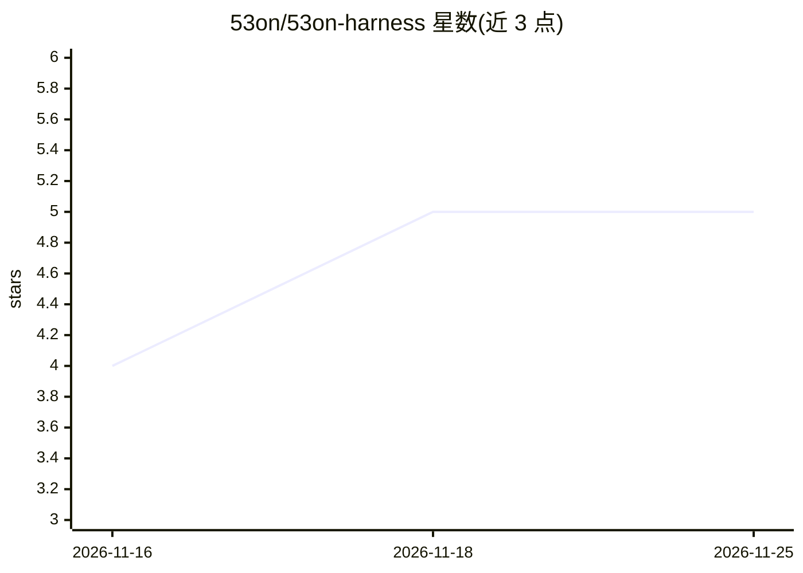

# 53on/53on-harness

⭐ 5 · JavaScript · MIT · 推送 2026-11-23 · [GitHub](https://github.com/53on/53on-harness) · [官网](https://53on.com/harness/) · 个人维护

**给桌面 AI 提供本地持久记忆与操控 PC 能力的开源外壳**

一个 Electron 桌面应用（仅 Windows），作为 53ON 的开源外壳：为 AI 提供驻留本地的记忆（MemoriaBios，模拟遗忘曲线与睡眠整合，无额外模型调用）、终端/文件/屏幕/摄像头/麦克风的 PC 操控能力，以及语音转文字。可与 Claude Code 在 VS Code 或终端联动，通过快捷键注入方式传递提示词，并有 manual/plan/auto/bypass 四级权限模式审计 AI 对 PC 的请求。记忆引擎与 Body/Cable/Ear 补充件为签名闭源代码，随 53ON 计划分发，需从 53on.com 获取。

## 筛选速览

| 维度 | 判定 | 备注 |
|---|---|---|
| AI 角色 | `ai-native` | 本体是模型或模型工具 |
| 许可风险 | `permissive` | MIT |
| 部署形态 | `desktop` | 安装包/桌面程序 |
| 模型依赖 | locked-api |  |
| 硬件要求 | — | 无带数字的原话,不猜 |
| 安装摩擦 | `low` | 无编译、无系统依赖或容器化 |
| 成熟度 | — | 结构信号不足 |

## 能力要点

- MemoriaBios 记忆引擎在本地以纯代码运行，含遗忘曲线、去重警告与睡眠整合
- 通过 Harness Cable 连接 Claude Code，会话启动/压缩后自动恢复记忆
- 四级权限模式（manual/plan/auto/bypass）控制 AI 对 PC 的操作范围
- 命令行工具可注册为插件，由用户或 AI 接入

## 适用场景

- 让 Claude Code 跨会话保留本地记忆
- 在个人 PC 上给 AI 配置终端、浏览器与语音操控能力
- 通过手机消息远程向桌面 AI 发送定时或即时提示

## 场景标签

`Agent 记忆` `GUI 自动化` `AI 助手` · 领域:Agent 开发

## 证据(README 行号)

> L9: The open desktop shell of 53ON: an Electron app that gives your AI hands, eyes and voice on your own PC. You stay th
> L47: - **On its own, with an API.** The AI runs in 53ON's own chat. Bring your key from Anthropic, OpenAI, Google, DeepS
> L58: - A memory that stays between sessions, on your PC, and can hold photos, audio and video.

## 星数曲线

2026-11-16 4 → 2026-11-25 5（+1）

---
*卡片 v1 · prompt 1.4 · 生成 2026-11-21 · 置信度 high · 依据 README sha `62ab3d3d7c98` · [字段定义](../../DATASET.md)*
