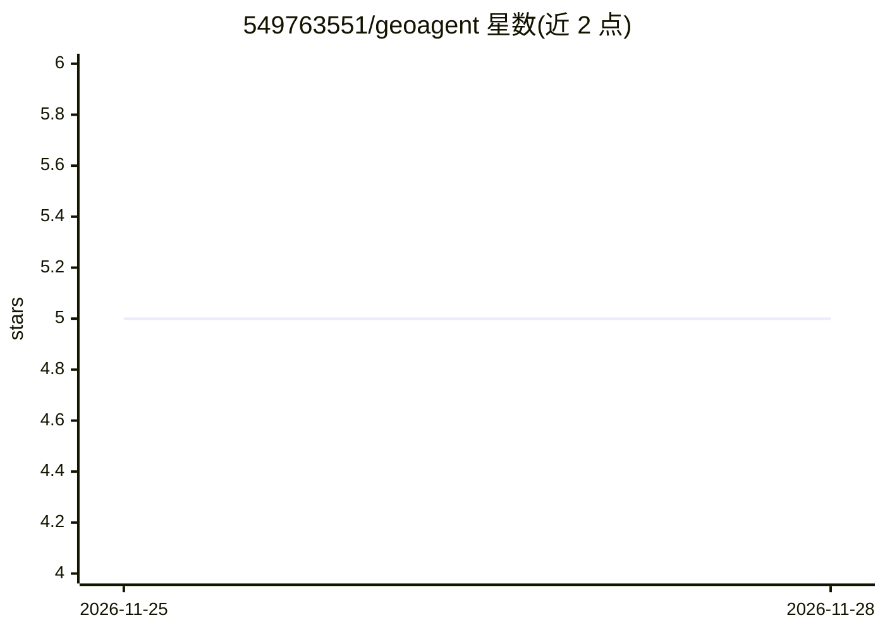

# 549763551/geoagent

⭐ 5 · Python · MIT · 推送 2026-10-20 · [GitHub](https://github.com/549763551/geoagent) · 个人维护 · 中文 README

**面向遥感分析人员的大模型栅格分析智能体**

以自然语言驱动的遥感栅格分析智能体，通过 LLM 意图解析、ReAct 规划与 11 个遥感工具调用，完成趋势分析、变化检测、指数计算、分区统计、专题制图与 Markdown/HTML 报告生成，经 FastAPI + SSE 流式输出到浏览器工作台。内置 18 个数据集目录定义，数据按目录约定放置即可使用；未配置 API Key 时自动降级为关键词规则的离线模式。仓库不含真实遥感数据，仅提供数学合成演示数据。

## 筛选速览

| 维度 | 判定 | 备注 |
|---|---|---|
| AI 角色 | `ai-native` | 本体是模型或模型工具 |
| 许可风险 | `permissive` | MIT |
| 部署形态 | `library` | 以包/库形式分发 |
| 模型依赖 | locked-api |  |
| 硬件要求 | — | 无带数字的原话,不猜 |
| 安装摩擦 | `low` | 无编译、无系统依赖或容器化 |
| 成熟度 | — | 结构信号不足 |

## 能力要点

- 11 个遥感分析工具以 OpenAI Function Calling 协议暴露，统一注册表调度
- 双运行模式：在线 LLM 驱动，未配置 Key 或调用失败时自动降级为离线规则模式
- 内置 18 个数据集别名/单位/时间范围定义，支持按 DATASET_SPECS 接入自有 GeoTIFF 数据
- 长短期记忆：会话内轨迹与跨会话经验沉淀（memory.jsonl）

## 适用场景

- 用一句话分析多年 NDVI 变化趋势与显著性
- 对比不同年份土地利用并生成专题对比图
- 评估区域生态质量并自动汇总分析报告
- 接入自有 GeoTIFF 数据做变化检测与分区统计

## 场景标签

`数据分析` · 领域:效率与自动化

## 证据(README 行号)

> L3: 用一句自然语言下达遥感分析任务，智能体自主完成
> L24: |任务理解|LLM 结构化解析意图（目标 / 任务类型 / 数据集 / 指数 / 年份 / 交付物），未配置 Key 时退化为关键词规则解析|
> L64: - **在线模式**：配置 `LLM_API_KEY` 后启用。由大模型完成任务理解、规划、ReAct 追加调用与结论撰写。

## 星数曲线

2026-11-25 5 → 2026-11-28 5（+0）

---
*卡片 v1 · prompt 1.4 · 生成 2026-11-24 · 置信度 mid · 依据 README sha `b888b3810214` · [字段定义](../../DATASET.md)*
