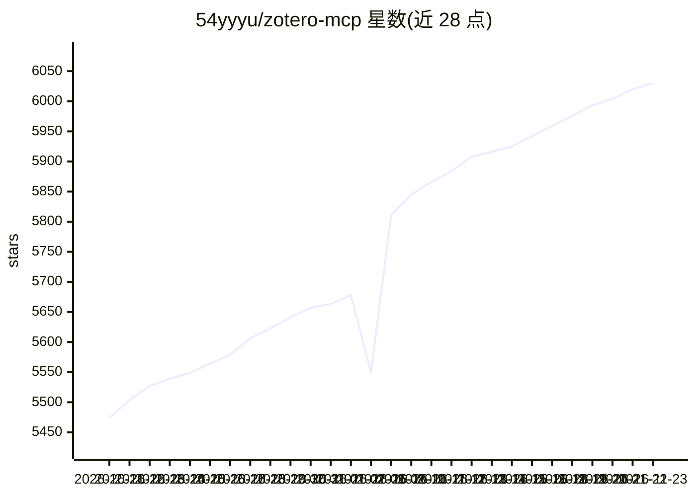

# 54yyyu/zotero-mcp

⭐ 6,030 · Python · MIT · 推送 2026-11-19 · [GitHub](https://github.com/54yyyu/zotero-mcp) · [官网](https://stevenyuyy.com/zotero-mcp/) · 个人维护

**通过 MCP 将 Zotero 文献库接入 Claude/ChatGPT 等 AI 助手**

一个 Python 包（zotero-mcp-server），提供三种方式把 Zotero 研究文献库连接到 AI 助手：MCP server（面向 Claude Desktop、ChatGPT 等无 shell 的聊天客户端）、zotero-cli 加 agent skill（面向 Claude Code、Codex 等有 shell 的 agent，上下文开销从约 8k tokens 降到 98 tokens）、以及内嵌 Zotero 的聊天面板插件（Zotero Agent，.xpi，AGPL-3.0）。功能覆盖检索（含语义搜索）、读取元数据/BibTeX/PDF 全文与页图、PDF 标注、按 DOI/ISBN 等写入条目、Scite 引用统计。本地模式直接读 zotero.sqlite，写入走 Zotero 10+ 本地 API 或 Web API。MIT 许可（插件除外）。

## 筛选速览

| 维度 | 判定 | 备注 |
|---|---|---|
| AI 角色 | `ai-ecosystem` | LLM/agent 周边工具 |
| 许可风险 | `permissive` | MIT |
| 部署形态 | `library` | 以包/库形式分发 |
| 模型依赖 | local-ok | 支持本地模型 |
| 硬件要求 | — | 无带数字的原话,不猜 |
| 安装摩擦 | `low` | 无编译、无系统依赖或容器化 |
| 成熟度 | — | 结构信号不足 |

## 能力要点

- 三种接入路径：MCP server、CLI+agent skill、Zotero 内聊天面板插件
- 语义搜索支持本地、OpenAI、Gemini、Ollama embeddings（ChromaDB/sentence-transformers）
- 读取 PDF 元数据、全文、页区间与页图；支持高亮与区域框标注
- agent skill 路径上下文开销 98 tokens，MCP server 默认配置为 7,752 tokens

## 适用场景

- 在 Claude Desktop 里对话式检索和总结自己的 Zotero 文献库
- 让 Claude Code/Cursor 等 agent 通过 CLI 管理条目、标注 PDF
- 在 Zotero 内边读 PDF 边向聊天面板提问，回答带页码引用链接
- 按语义查找文献并获取 Scite 引用统计与撤稿提醒

## 场景标签

`语义搜索` `科研工具` `文档问答` · 领域:知识与检索

## 证据(README 行号)

> L22: **Zotero MCP** connects your Zotero research library with ChatGPT, Claude, and other AI assistants (e.g., Cherry St
> L30: ||**MCP server**|**`zotero-cli` + agent skill**|**Zotero Agent**|
> L150: |Docker|Container images and runtime modes|

## 星数曲线

2026-10-21 5,474 → 2026-11-23 6,030（+556）

---
*卡片 v1 · prompt 1.4 · 生成 2026-11-22 · 置信度 high · 依据 README sha `e9c1ecfa7348` · [字段定义](../../DATASET.md)*
