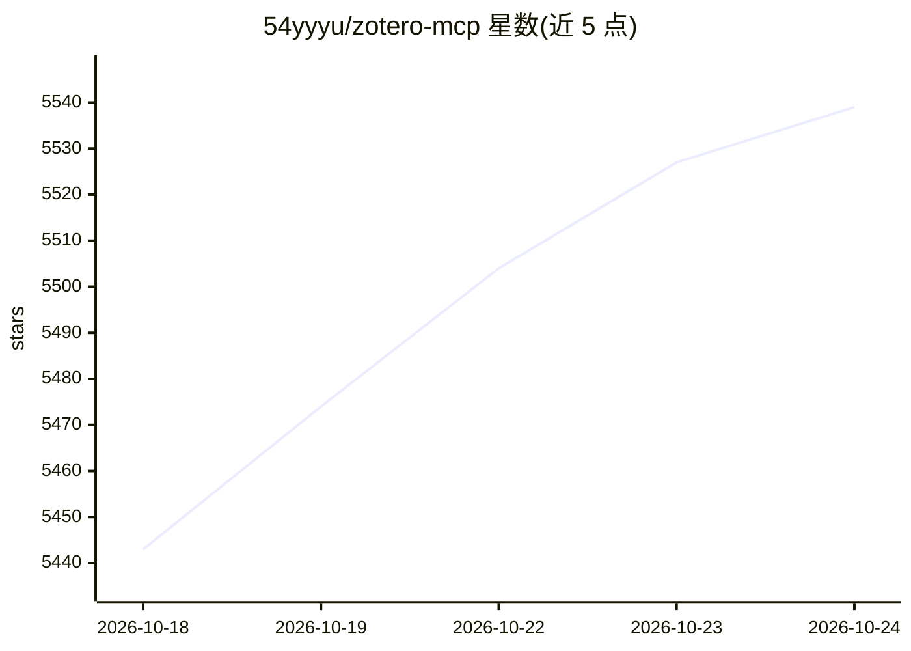

# 54yyyu/zotero-mcp

⭐ 5,539 · Python · MIT · 推送 2026-10-16 · [GitHub](https://github.com/54yyyu/zotero-mcp) · [官网](https://stevenyuyy.com/zotero-mcp/) · 个人维护

**将 Zotero 文献库接入 Claude/ChatGPT 等 AI 助手的 MCP 服务**

一个 Python 包（zotero-mcp-server），通过 Model Context Protocol 把 Zotero 文献库接入 Claude Desktop、ChatGPT、Cursor 等 AI 客户端，提供三条使用路径：MCP server、zotero-cli + agent skill、Zotero Agent 插件（在 Zotero 内嵌聊天面板）。功能覆盖文献检索（含语义检索，支持本地/OpenAI/Gemini/Ollama 嵌入）、PDF 全文与元数据读取、批注写入、按 DOI/URL/BibTeX 添加条目。本地模式直接读取 zotero.sqlite，写入需 Zotero 10+ 或 Web API key。需 Python 3.10+，可选 extras 按功能安装。

## 筛选速览

| 维度 | 判定 | 备注 |
|---|---|---|
| AI 角色 | `ai-ecosystem` | LLM/agent 周边工具 |
| 许可风险 | `permissive` | MIT |
| 部署形态 | `library` | 以包/库形式分发 |
| 模型依赖 | local-ok | 支持本地模型 |
| 硬件要求 | — | 无带数字的原话,不猜 |
| 安装摩擦 | `low` | 无编译、无系统依赖或容器化 |
| 成熟度 | — | 结构信号不足 |

## 能力要点

- 三种接入路径：MCP server、zotero-cli agent skill（98 token 常驻）、Zotero Agent 插件
- 语义检索支持本地、OpenAI、Gemini 或 Ollama 嵌入（可选 extras）
- PDF 批注精确到词/图/表/公式，答案附 zotero:// 页面级引用链接
- 本地模式直读 zotero.sqlite，写入走 Zotero 10+ 本地 API 或 Web API

## 适用场景

- 在 Claude/ChatGPT 中检索、阅读和总结自己 Zotero 库里的论文
- 让 AI 助手给 PDF 添加高亮批注、整理条目与标签
- 在 Zotero 内通过聊天面板针对当前阅读页面提问并跳转引用

## 场景标签

`科研工具` `语义搜索` `文档问答` · 领域:知识与检索

## 证据(README 行号)

> L22: **Zotero MCP** connects your Zotero research library with ChatGPT, Claude, and other AI assistants (e.g., Cherry St
> L28: One package, `zotero-mcp-server`, ships all three. Pick the one that fits where you work.
> L30: ||**MCP server**|**`zotero-cli` + agent skill**|**Zotero Agent**|

## 星数曲线

2026-10-18 5,443 → 2026-10-24 5,539（+96）

---
*卡片 v1 · prompt 1.4 · 生成 2026-10-20 · 置信度 high · 依据 README sha `888f7937240d` · [字段定义](../../DATASET.md)*
