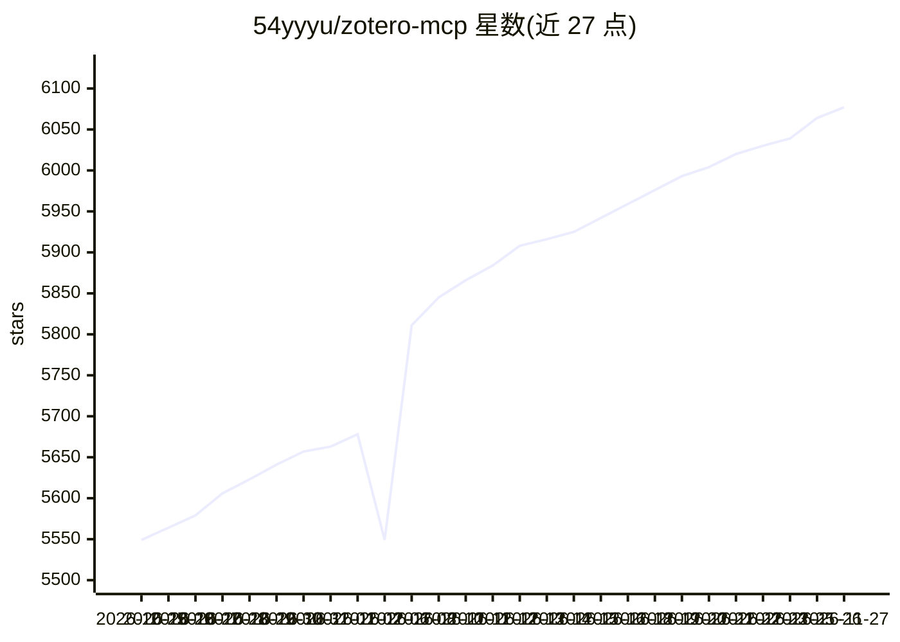

# 54yyyu/zotero-mcp

⭐ 6,077 · Python · MIT · 推送 2026-11-24 · [GitHub](https://github.com/54yyyu/zotero-mcp) · [官网](https://stevenyuyy.com/zotero-mcp/) · 个人维护

**把 Zotero 文献库接入 Claude/ChatGPT 等 AI 助手的 MCP 服务器**

一个 PyPI 包（zotero-mcp-server）提供三种使用路径：面向无 shell 的 MCP 客户端（Claude Desktop、ChatGPT 等）的 MCP 服务器、面向带 shell 的 agent（Claude Code、Codex、Cursor 等）的 zotero-cli 加 agent skill、以及嵌入 Zotero 的 Zotero Agent 聊天插件。功能覆盖标题/作者/全文/语义检索、读取 PDF 元数据与页面范围、标注（高亮与区域框）、经 DOI/URL/BibTeX 添加文献与管理集合标签。本地模式直接读取 zotero.sqlite，写入经 Zotero 10+ 本地 API 或 web API。语义检索为可选 extra，依赖 ChromaDB 与 OpenAI/Gemini/Ollama 嵌入。

## 筛选速览

| 维度 | 判定 | 备注 |
|---|---|---|
| AI 角色 | `ai-ecosystem` | LLM/agent 周边工具 |
| 许可风险 | `permissive` | MIT |
| 部署形态 | `library` | 以包/库形式分发 |
| 模型依赖 | local-ok | 支持本地模型 |
| 硬件要求 | — | 无带数字的原话,不猜 |
| 安装摩擦 | `low` | 无编译、无系统依赖或容器化 |
| 成熟度 | — | 结构信号不足 |

## 能力要点

- 三种接入路径：MCP server、zotero-cli + agent skill、Zotero 内嵌聊天面板
- 语义检索支持本地、OpenAI、Gemini、Ollama 嵌入
- PDF 页级标注（高亮/区域框）与经 Scite 的引文计数与撤稿提醒（可选）
- 本地模式直接读取 zotero.sqlite，无需额外服务

## 适用场景

- 在 Claude Desktop 里直接检索、总结我的 Zotero 文献库
- 让 Claude Code/Cursor 这类 agent 以更低 token 开销操作文献
- 在 Zotero 阅读 PDF 时在旁边面板与 AI 讨论并定位引用页

## 场景标签

`语义搜索` `科研工具` · 领域:知识与检索

## 证据(README 行号)

> L22: **Zotero MCP** connects your Zotero research library with ChatGPT, Claude, and other AI assistants (e.g., Cherry St
> L30: ||**MCP server**|**`zotero-cli` + agent skill**|**Zotero Agent**|
> L39: - **Search** by title, author, tag, collection, full text, or meaning (semantic search with local, OpenAI, Gemini, 

## 星数曲线

2026-10-25 5,549 → 2026-11-27 6,077（+528）

---
*卡片 v1 · prompt 1.4 · 生成 2026-11-26 · 置信度 high · 依据 README sha `7eb6a6ba821d` · [字段定义](../../DATASET.md)*
