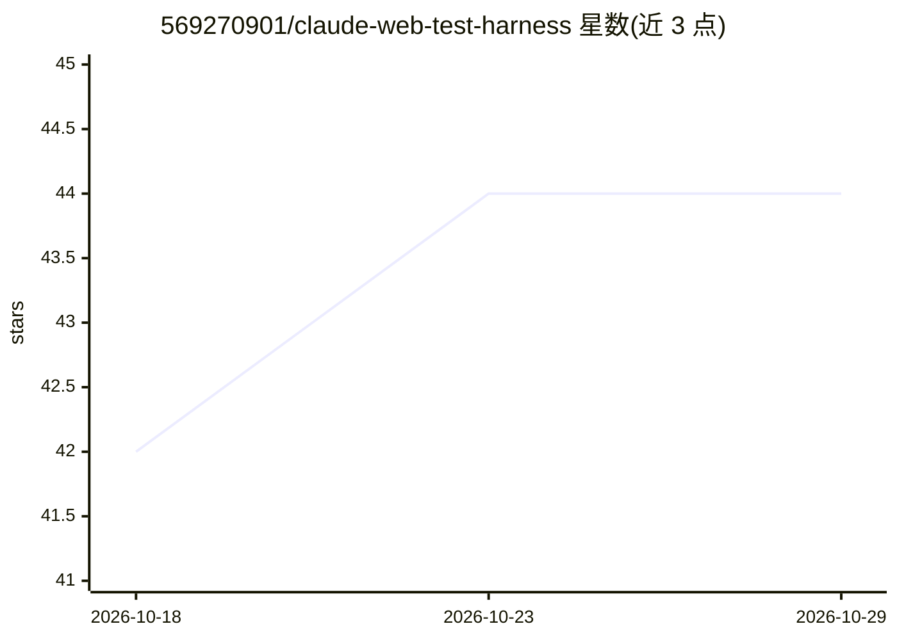

# 569270901/claude-web-test-harness

⭐ 44 · Python · MIT · 推送 2026-10-26 · [GitHub](https://github.com/569270901/claude-web-test-harness) · 个人维护 · 中文 README

**Claude Code 驱动的多 agent UI 测试编排骨架，自然语言生成并运行测试**

领域无关的 Web UI 自动化测试编排骨架：本体是一组 markdown 指令加普通 pytest-playwright 项目，依赖 Claude Code 等可运行 AI agent 的编码工具充当调度器，把「探索页面→分解检查清单→生成用例→写代码→运行自修复」五步分配给 5 个角色，通过文档交接并在两个检查点暂停等待用户确认。业务逻辑通过目录约定与 CLAUDE.md 注入，附本地确认控制台（纯标准库）、用例编辑审计日志、提交前合规静态扫描。Codex/CodeBuddy 等其他工具可通过兼容提示词以单 agent 串演各角色方式运行，但无上下文隔离。仓库自带演示为 TesterHome 只读流程，缺少基于真实登录状态的完整示例运行（作者列入待办）。

## 筛选速览

| 维度 | 判定 | 备注 |
|---|---|---|
| AI 角色 | `ai-ecosystem` | LLM/agent 周边工具 |
| 许可风险 | `permissive` | MIT |
| 部署形态 | `library` | 以包/库形式分发 |
| 模型依赖 | locked-api |  |
| 硬件要求 | — | 无带数字的原话,不猜 |
| 安装摩擦 | `low` | 无编译、无系统依赖或容器化 |
| 成熟度 | `idea` | |

## 能力要点

- 五角色流水线经文档交接，两处 GATE 暂停等待人工确认
- 7 类检查清单先于用例生成，不确定项标记并预分类
- 本体为 markdown 指令 + pytest-playwright 项目，不绑定特定 agent 工具
- 本地确认控制台支持用例编辑（按用例 ID、带快照与审计日志）与提交前合规扫描

## 适用场景

- 用自己的 Web 项目替换演示后，以自然语言描述需求让其生成并运行 UI 测试
- 在用例生成前的检查点核对覆盖范围、补齐遗漏项
- 人工与自动化测试结果分道记录并高亮不一致的用例

## 场景标签

`多智能体` `浏览器自动化` `编码 Agent` · 领域:Agent 开发

## 证据(README 行号)

> L5: A multi-agent UI test automation framework driven by Claude Code. Drop it into your Web project, tell it "help me te
> L76: This harness relies on an **AI coding tool** to act as the "dispatcher" — it's responsible for
> L78: is just **a pile of markdown instructions + an ordinary pytest-playwright project**; it isn't

## 星数曲线

2026-10-18 42 → 2026-10-29 44（+2）

---
*卡片 v1 · prompt 1.4 · 生成 2026-10-25 · 置信度 mid · 依据 README sha `4643c30257c9` · [字段定义](../../DATASET.md)*
