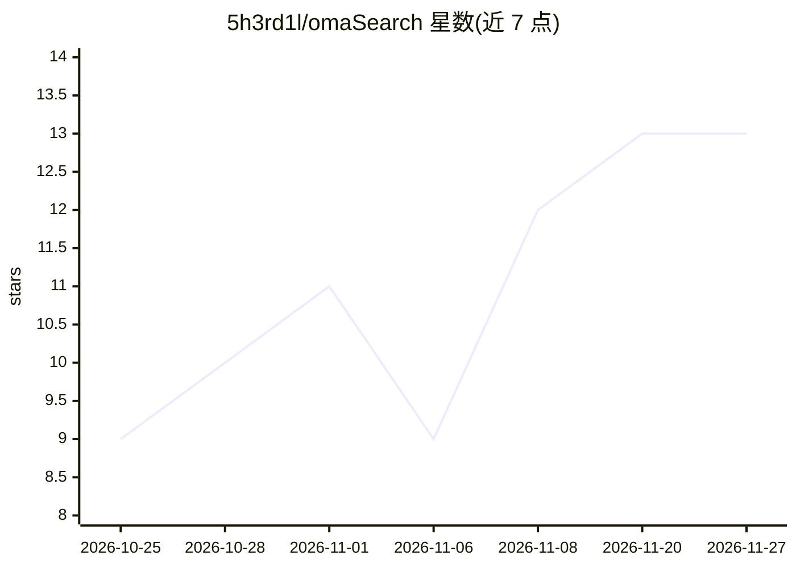

# 5h3rd1l/omaSearch

⭐ 13 · QML · MIT · 推送 2026-10-01 · [GitHub](https://github.com/5h3rd1l/omaSearch) · 个人维护

**Omarchy 下的全局 AI 提问浮层：Enter 问代理，Ctrl+Enter 搜 Google**

面向 Omarchy/Hyprland 桌面的 Quickshell 插件，在任何界面呼出毛玻璃浮层向 AI 代理提问并就地显示流式回答。支持 Claude、Codex、OpenCode、Gemini 等多个代理 CLI 作为后端，可继续同会话追问、粘贴图片、查看代理执行的命令及输出；默认开启 Safe mode，命令执行前需 Allow/Deny。通过 omarchy plugin 命令安装，需 Python 3、omarchy-shell 与 PATH 上的代理 CLI。

## 筛选速览

| 维度 | 判定 | 备注 |
|---|---|---|
| AI 角色 | `ai-native` | 本体是模型或模型工具 |
| 许可风险 | `permissive` | MIT |
| 部署形态 | `None` |  |
| 模型依赖 | locked-api |  |
| 硬件要求 | — | 无带数字的原话,不猜 |
| 安装摩擦 | `low` | 无编译、无系统依赖或容器化 |
| 成熟度 | — | 结构信号不足 |

## 能力要点

- 一个输入框双通道：Enter 问代理、Ctrl+Enter 谷歌搜索
- 多代理后端：Claude、Codex、OpenCode、Gemini、Grok、Crush、Pi
- Safe mode 命令执行审批（Allow/Always/Deny），可查看每条命令输出
- 会话管理：近期会话列表、临时会话、粘贴图片、流式回答

## 适用场景

- 在任何应用中随时向 AI 代理提问而不切换窗口
- 同一浮层内连续追问并保留近期会话
- 让代理执行命令时逐条审批，控制风险
- 快速粘贴截图让代理分析（Claude，最大 5 MB）

## 场景标签

`AI 助手` · 领域:对话与助手

## 证据(README 行号)

> L3: Quick AI search for Omarchy. Press a key, ask, keep working.
> L12: omaSearch opens a glass overlay over whatever you're doing, sends your question to Claude (or your default agent: C
> L114: - Omarchy with `omarchy-shell` (Quickshell)

## 星数曲线

2026-10-25 9 → 2026-11-27 13（+4）

---
*卡片 v1 · prompt 1.4 · 生成 2026-11-18 · 置信度 high · 依据 README sha `566c438b46ab` · [字段定义](../../DATASET.md)*
