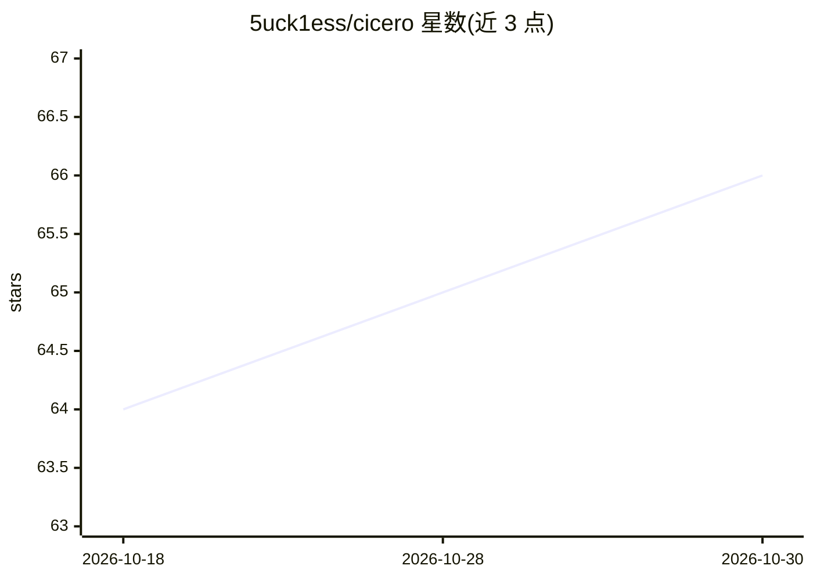

# 5uck1ess/cicero

⭐ 66 · TypeScript · MIT · 推送 2026-10-26 · [GitHub](https://github.com/5uck1ess/cicero) · 个人维护

**自托管语音前端：用语音对话驱动编码 agent 干活**

Cicero 是部署在本地/局域网的语音界面，用户从浏览器、PWA 或可选的 Telegram 电话对编码 agent 说话，agent 执行任务并出 PR。语音链路含本地 STT、逐句流式 TTS、barge-in 打断、语义轮次结束检测（约 8M 参数本地小模型）、可选语音情绪识别与零样本本地音色克隆。大脑是可插拔插槽：支持 Claude Code、Codex、Gemini、Qwen、任意 ACP agent 或 OpenAI 兼容端点。以 git clone + Bun 从源码安装，经 setup 向导生成配置；项目标注处于活跃开发阶段，部分功能（office lanes）需手动配置。

## 筛选速览

| 维度 | 判定 | 备注 |
|---|---|---|
| AI 角色 | `ai-ecosystem` | LLM/agent 周边工具 |
| 许可风险 | `permissive` | MIT |
| 部署形态 | `None` |  |
| 模型依赖 | — | README 未给出锁定关系 |
| 硬件要求 | — | 无带数字的原话,不猜 |
| 安装摩擦 | `medium` | 含编译或系统依赖之一 |
| 成熟度 | `idea` | |

## 能力要点

- 约 1 秒首句语音响应（本地 NVIDIA GPU 环境），重活在语音环外异步执行
- 本地零声音色克隆（单 WAV 参考，36–46ms/句）与 mid-sentence 打断
- 本地语义轮次结束检测（约 12ms CPU）与可选 emotion2vec 语音情绪识别
- agent 无关：支持 ACP 协议与 OpenAI 兼容端点，多 agent lanes 可切换

## 适用场景

- 一边写代码一边用语音让 agent 修测试、提 PR
- 在浏览器或 Telegram 通话中与本地编码 agent 对话
- 用自己的音色克隆让 agent 语音回复

## 场景标签

`语音 Agent` `编码 Agent` · 领域:编码与开发

## 证据(README 行号)

> L5: **Cicero is a self-hosted voice interface for coding agents: you speak, it answers out loud, and your agent does the
> L63: **Supported agents:** Claude Code, Codex, Gemini, Qwen, any ACP agent (Hermes, `codex-acp`, `claude-acp`, …), or an

## 星数曲线

2026-10-18 64 → 2026-10-30 66（+2）

---
*卡片 v1 · prompt 1.4 · 生成 2026-10-24 · 置信度 high · 依据 README sha `9ec5154d4dcf` · [字段定义](../../DATASET.md)*
