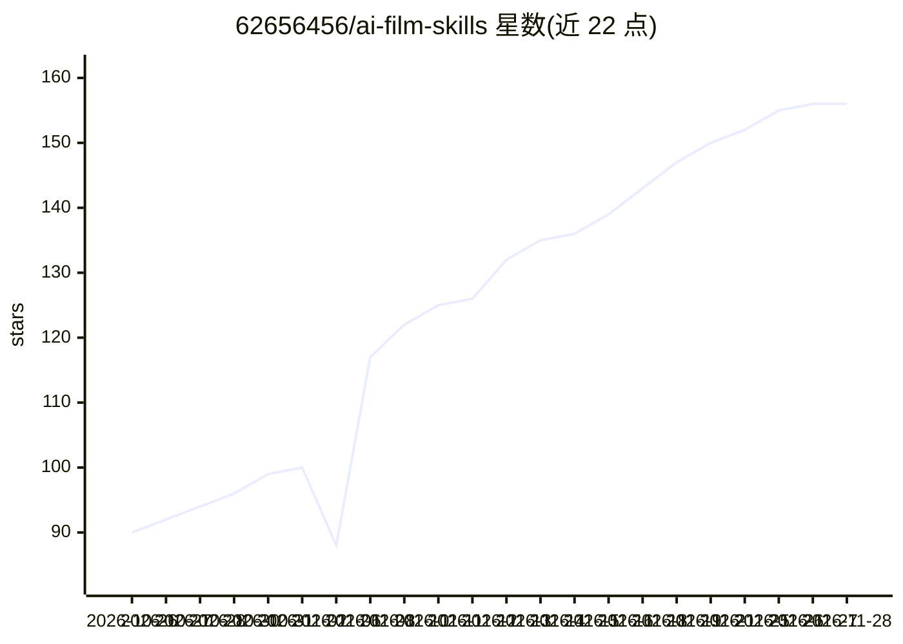

# 62656456/ai-film-skills

⭐ 156 · Python · Apache-2.0 · 推送 2026-11-06 · [GitHub](https://github.com/62656456/ai-film-skills) · [官网](https://62656456.github.io/ai-film-skills/) · 个人维护 · 中文 README

**面向 AI 影视创作者的 Agent 技能包集合（21 个模块）**

面向 AI 影视、短片与剧情视频创作者的 Agent 技能库，含 22 个源码包（19 常规 + 3 实验）与 44 份中英说明，覆盖故事与导演、人物/场景/道具资产、八类类型视觉、分镜与摄影、提示词编译、实际视频生产、市场研究与知识写入等职责。技能是供宿主代理读取执行的创作指令包，不内置视频模型、账户或制作软件；实际出图与出片依赖宿主工具条件。各阶段可独立使用并交接已确认的创作决定。

## 筛选速览

| 维度 | 判定 | 备注 |
|---|---|---|
| AI 角色 | `ai-knowledge` | 知识聚合/清单类 |
| 许可风险 | `permissive` | Apache-2.0 |
| 部署形态 | `library` | 以包/库形式分发 |
| 模型依赖 | — | README 未给出锁定关系 |
| 硬件要求 | — | 无带数字的原话,不猜 |
| 安装摩擦 | `low` | 无编译、无系统依赖或容器化 |
| 成熟度 | `idea` | |

## 能力要点

- 22 个独立技能包覆盖剧本、资产、分镜、提示词与制作全流程
- 分镜技能内置 115 个 FCML 摄影机制供检索绑定
- 安装器支持 codex、claude-code、trae、codebuddy 四种宿主平台
- 保留历史作品、分镜研究与白模预演等证据记录并标注验收边界

## 适用场景

- 从点子或小说生成可读剧本并做导演诊断
- 为人物、场景、道具建立跨镜头一致的视觉资产
- 将已定镜头编译成视频生成的母提示词
- 用 3D 白模检查机位、视差与走位

## 场景标签

`提示工程` `视频生成` `AI 写作` · 领域:Agent 开发

## 证据(README 行号)

> L32: 这里的 Skill 是给宿主代理读取和执行的创作指令包，**不内置视频模型、账户、额度或全部制作软件**。实际图片、视频与预演需要宿主具备相应工具和执行条件。
> L348: python scripts/install_skill.py director-agent --platform codex

## 星数曲线

2026-10-26 90 → 2026-11-28 156（+66）

---
*卡片 v1 · prompt 1.4 · 生成 2026-11-28 · 置信度 high · 依据 README sha `0460799695ac` · [字段定义](../../DATASET.md)*
