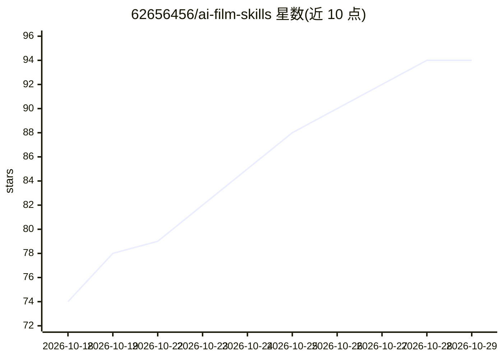

# 62656456/ai-film-skills

⭐ 94 · Python · Apache-2.0 · 推送 2026-10-18 · [GitHub](https://github.com/62656456/ai-film-skills) · [官网](https://62656456.github.io/ai-film-skills/) · 个人维护 · 中文 README

**AI 影视创作的 21 个 Agent 技能包：剧本、资产、分镜到成片流程**

面向 AI 影视、短片与剧情视频创作者的独立 Agent Skills 仓库：21 个源码包（18 常规 + 3 实验）覆盖编剧导演、人物/场景/道具资产、八种类型视觉、分镜与摄影、提示词编译、实际视频生产、市场研究与知识审核、网页界面设计，以及 3D 白模预演等实验包。技能是给宿主代理读取执行的创作指令包，不内置视频模型、账户或制作软件，实际生成需宿主具备相应工具。安装器支持 codex、claude-code、trae、codebuddy 平台，也可用 Skills CLI 安装。README 保留研究画廊并逐批标注证据边界。

## 筛选速览

| 维度 | 判定 | 备注 |
|---|---|---|
| AI 角色 | `ai-ecosystem` | LLM/agent 周边工具 |
| 许可风险 | `permissive` | Apache-2.0 |
| 部署形态 | `library` | 以包/库形式分发 |
| 模型依赖 | — | README 未给出锁定关系 |
| 硬件要求 | — | 无带数字的原话,不猜 |
| 安装摩擦 | `low` | 无编译、无系统依赖或容器化 |
| 成熟度 | `idea` | |

## 能力要点

- 21 个独立技能包（18 常规 + 3 实验），42 份中英说明
- 安装器支持 codex / claude-code / trae / codebuddy 四个宿主平台
- 分镜包内置 115 个 FCML 机制供按需检索绑定
- 各阶段成果可交接：剧本→资产→分镜→母提示词→实际制作

## 适用场景

- 把故事或小说写成可读剧本并确定导演方案
- 设计人物、场景、道具的参考图与身份/空间合同
- 编排 30 秒分镜并编译为六模块视频母提示词
- 组织实际视频生成、选片剪辑与看片修复

## 场景标签

`提示工程` `视频生成` · 领域:Agent 开发

## 证据(README 行号)

> L32: 这里的 Skill 是给宿主代理读取和执行的创作指令包，**不内置视频模型、账户、额度或全部制作软件**。实际图片、视频与预演需要宿主具备相应工具和执行条件。
> L345: 把最后一行的 `director-agent` 换成上方需要的技能名。安装器支持 `codex`、`claude-code`、`trae`、`codebuddy`；也可使用 `--target` 指定项目目录。实验包需要额外明确

## 星数曲线

2026-10-18 74 → 2026-10-29 94（+20）

---
*卡片 v1 · prompt 1.4 · 生成 2026-10-24 · 置信度 high · 依据 README sha `65c8692f4340` · [字段定义](../../DATASET.md)*
