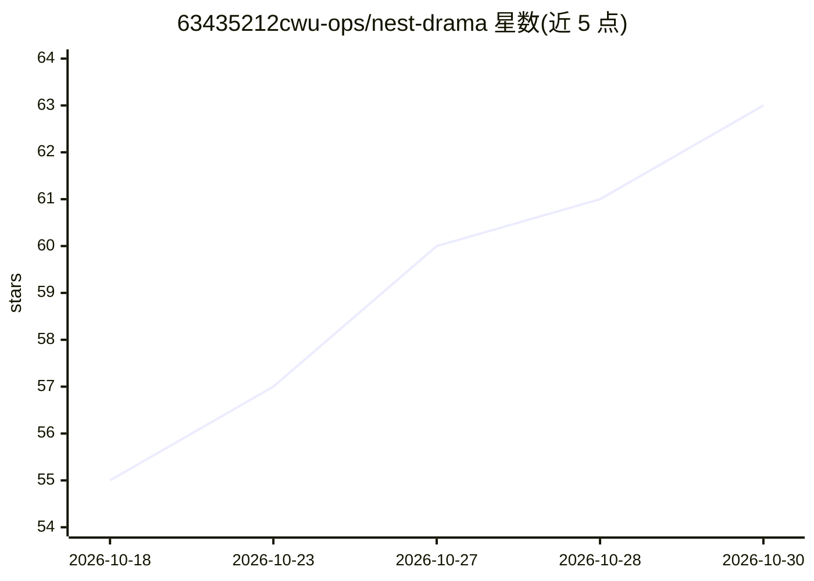

# 63435212cwu-ops/nest-drama

⭐ 63 · Python · AGPL-3.0 · 推送 2026-09-13 · [GitHub](https://github.com/63435212cwu-ops/nest-drama) · [官网](https://github.com/63435212cwu-ops/nest-drama/releases/latest) · 个人维护 · 中文 README

**本地运行的单元剧创作引擎：独立角色模拟体驱动剧情**

面向中长篇小说与短篇创作者的单元剧生成引擎：导入世界观、人物小传、大纲等材料后构建世界，运行时每个角色是隔离的 agent，只知道该知道的信息并按自身性格行动；舞台监督每轮指定驱动者，监督者判定行为合理性，零 token linter 与数字台账抑制 AI 痕迹；剧情节点通过世界内因果达成。纯 Python 标准库实现，零第三方依赖，材料与密钥本地存储，通过 OpenAI 兼容端点接入任意 LLM。附带太阳系式 3D 星图可视化。

## 筛选速览

| 维度 | 判定 | 备注 |
|---|---|---|
| AI 角色 | `ai-native` | 本体是模型或模型工具 |
| 许可风险 | `viral` | AGPL-3.0 |
| 部署形态 | `None` |  |
| 模型依赖 | — | README 未给出锁定关系 |
| 硬件要求 | — | 无带数字的原话,不猜 |
| 安装摩擦 | `low` | 无编译、无系统依赖或容器化 |
| 成熟度 | — | 结构信号不足 |

## 能力要点

- 每个角色为隔离 agent，仅见其应知信息并按自身性格言行
- 剧情节点通过世界内因果达成，支持注入/采访/暂停/续写/导出
- 零 token linter、监督者、数字台账三层抑制 AI 痕迹
- 纯 Python 标准库，零第三方依赖，数据与密钥留在本机

## 适用场景

- 为长中篇小说生成单元故事、单元情节与卷情节
- 构建角色驱动而非轨道式的剧情世界并导出草稿
- 导入既有章节与大纲续写或推演剧情

## 场景标签

`AI 写作` · 领域:内容生成

## 证据(README 行号)

> L9: A unit-story creation engine: build a world for your work, then let independent characters act inside it and drive t
> L38: 1. **Build** — distil the worldview, the plot spine (must-hit / flexible beats) and three cards per character (core
> L39: 2. **Run** — each round a stage manager picks a driver and a target; every character is an isolated agent that sees

## 星数曲线

2026-10-18 55 → 2026-10-30 63（+8）

---
*卡片 v1 · prompt 1.4 · 生成 2026-10-24 · 置信度 high · 依据 README sha `97dbb0e9136e` · [字段定义](../../DATASET.md)*
