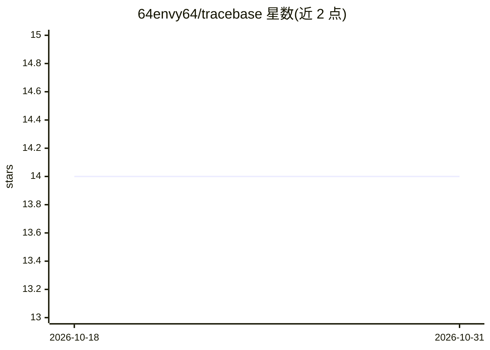

# 64envy64/tracebase

⭐ 14 · TypeScript · MIT · 推送 2026-06-03 · [GitHub](https://github.com/64envy64/tracebase) · [官网](https://tracebase.ink) · 组织维护

**给编码 Agent 的运行时记忆层：跨次运行复用已解决的问题**

面向编码 Agent（Claude Code/Cursor/Codex 及 OpenAI/Anthropic SDK）的记忆层：在运行时记录已解决的问题 trace 存入项目级 SQLite 模式库，下次遇到相似问题时通过指纹+FTS5/BM25、Thompson 采样加权检索注入上下文；另提供文件要点记忆（Gist）、死循环检测（Loop）、工具调用去重（Guard）与长会话折叠（Fold）五个模块。支持 MCP 注册、SDK 中间件包装与 HTTP 服务模式，本地部署，MIT 许可，附 holdout A/B 效果测量。README 给出 SWE-bench Verified 配对基准数据。

## 筛选速览

| 维度 | 判定 | 备注 |
|---|---|---|
| AI 角色 | `ai-ecosystem` | LLM/agent 周边工具 |
| 许可风险 | `permissive` | MIT |
| 部署形态 | `library` | 以包/库形式分发 |
| 模型依赖 | — | README 未给出锁定关系 |
| 硬件要求 | — | 无带数字的原话,不猜 |
| 安装摩擦 | `low` | 无编译、无系统依赖或容器化 |
| 成熟度 | — | 结构信号不足 |

## 能力要点

- 五模块：Recall/Gist/Loop/Guard/Fold 覆盖运行时失败模式
- 项目级 SQLite 模式库，指纹+FTS5/BM25+Thompson 采样检索与结果反馈闭环
- 适配 Claude Code/Cursor/Codex 自动检测，OpenAI/Anthropic SDK 中间件与 MCP/HTTP 接口
- 原子写入、审计日志、删除回滚与 holdout A/B 效果验证

## 适用场景

- 让编码 Agent 不再重复解决同类 bug，跨 PR 复用解法
- 100+ 轮长会话保持连贯，旧轮折叠为要点摘要
- 团队按基础设施方式在多主机部署 Agent 记忆并审计效果

## 场景标签

`Agent 记忆` · 领域:Agent 开发

## 证据(README 行号)

> L3: **Memory layer for coding agents.** Your agents stop re-solving the same problem.
> L44: One command. Auto-detects Claude Code / Cursor / Codex, writes the adapter, registers MCP, and initializes the loca
> L74: |**OpenAI SDK**|`wrapOpenAI(client, layer)` middleware|
> L76: |**Generic (LangChain, LangGraph, Agent SDK)**|`wrapGeneric(...)`|

## 星数曲线

2026-10-18 14 → 2026-10-31 14（+0）

---
*卡片 v1 · prompt 1.4 · 生成 2026-10-31 · 置信度 high · 依据 README sha `ad7174b50bfa` · [字段定义](../../DATASET.md)*
