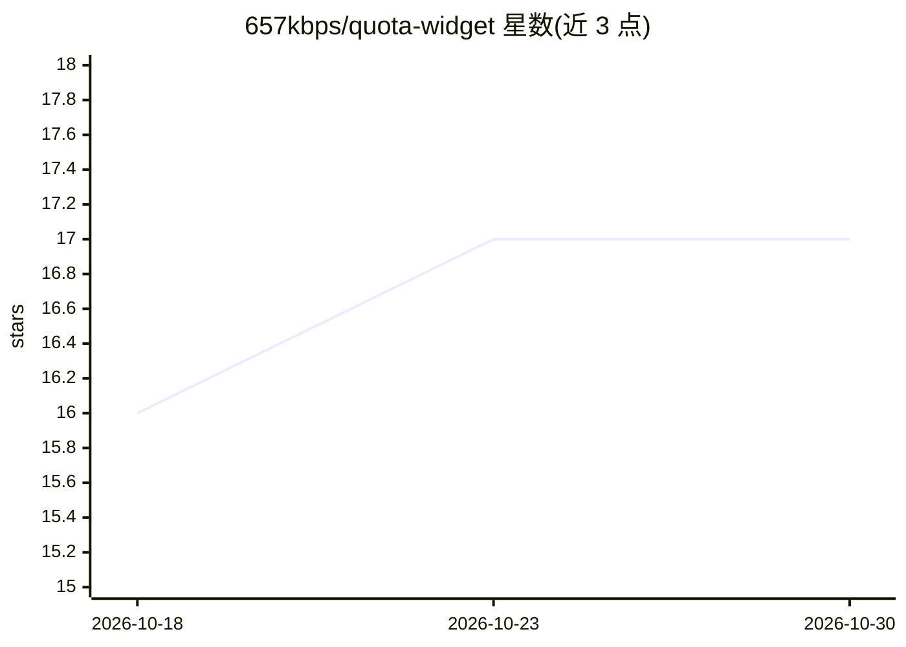

# 657kbps/quota-widget

⭐ 17 · Kotlin · 推送 2026-08-14 · [GitHub](https://github.com/657kbps/quota-widget) · 个人维护 · 中文 README

**Android 桌面小组件：一眼查看 AI API 余额与用量**

基于 Kotlin/KMP 与 Glance 的 Android 桌面小组件应用，读取 DeepSeek 账户余额、OpenCode Go 用量、Codex 订阅用量与 NewAPI 令牌余额，在主屏幕以标准/紧凑/总览三种尺寸展示。后台经 WorkManager 定时刷新并支持手动刷新；API Key 与 OAuth Token 经 Tink 加密后存入 DataStore；提供浅色/深色/跟随系统主题与自定义主题色，并附国产 ROM 后台保活指引。通过 GitHub Releases 分发 APK，也可用 Gradle 从源码构建。

## 筛选速览

| 维度 | 判定 | 备注 |
|---|---|---|
| AI 角色 | `ai-ecosystem` | LLM/agent 周边工具 |
| 许可风险 | `none` | — |
| 部署形态 | `None` |  |
| 模型依赖 | — | README 未给出锁定关系 |
| 硬件要求 | — | 无带数字的原话,不猜 |
| 安装摩擦 | `low` | 无编译、无系统依赖或容器化 |
| 成熟度 | — | 结构信号不足 |

## 能力要点

- 多平台监控：DeepSeek / OpenCode Go / Codex / NewAPI 的余额与用量
- 三种小组件尺寸（标准、紧凑、用量总览）适配不同桌面布局
- WorkManager 后台定时刷新 + 手动点按刷新
- API Key / OAuth Token 经 Tink 加密写入 DataStore

## 适用场景

- 在手机桌面随时查看 DeepSeek 或 Codex 的剩余额度
- 为自建 NewAPI 服务配置 Base URL + API Key 监控令牌用量
- 配置自动刷新，无需打开网页后台即可跟踪用量变化

## 场景标签

 · 领域:移动工具/API 监控

## 证据(README 行号)

> L5:  在 Android 桌面一眼查看 API 余额与用量的开源小组件
> L21: - **多平台监控**：DeepSeek 账户余额、OpenCode Go 用量、Codex 订阅用量（每周 / 每月）、NewAPI 令牌余额与用量

## 星数曲线

2026-10-18 16 → 2026-10-30 17（+1）

---
*卡片 v1 · prompt 1.4 · 生成 2026-10-30 · 置信度 high · 依据 README sha `18fcb92dee19` · [字段定义](../../DATASET.md)*
