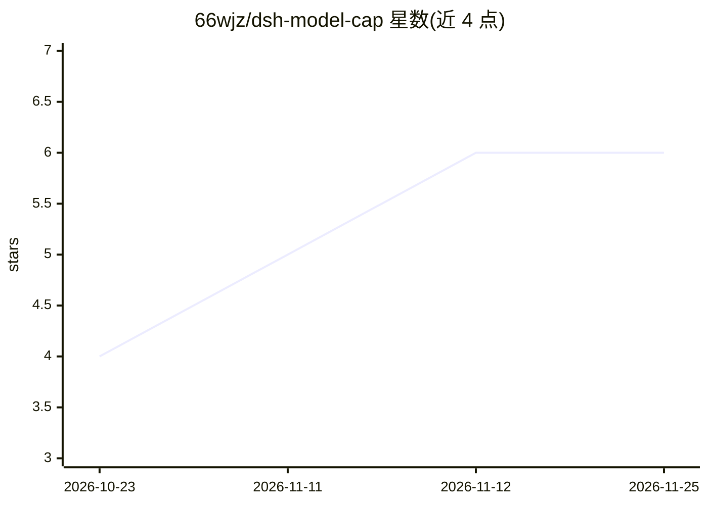

# 66wjz/dsh-model-cap

⭐ 6 · JavaScript · MIT · 推送 2026-10-24 · [GitHub](https://github.com/66wjz/dsh-model-cap) · [官网](https://github.com/66wjz/dsh-model-cap) · 个人维护 · 中文 README

**dsh 用户的提供商与模型管理插件控制台**

DeepSeek Harness（dsh）的插件，在设置中新增「提供商配置」导航页。功能覆盖提供商的新增/编辑/删除与凭据配置（API Key 可留空以适配本地模型或免鉴权网关）、从官方内置目录一键预置厂商、provider 级失败重试策略、模型的增删改与拖动排序、推理档位声明、按协议动态渲染的兼容性开关、连通测试与提供商禁用归档。安装要求 dsh >= 0.2.0-rc.1 与 Node.js >= 22，npm 发布后经 dsh plugin 命令安装，也支持本地源码路径安装。

## 筛选速览

| 维度 | 判定 | 备注 |
|---|---|---|
| AI 角色 | `ai-ecosystem` | LLM/agent 周边工具 |
| 许可风险 | `permissive` | MIT |
| 部署形态 | `library` | 以包/库形式分发 |
| 模型依赖 | — | README 未给出锁定关系 |
| 硬件要求 | — | 无带数字的原话,不猜 |
| 安装摩擦 | `low` | 无编译、无系统依赖或容器化 |
| 成熟度 | — | 结构信号不足 |

## 能力要点

- 提供商增删改，API Key 可留空以适配本地模型/免鉴权网关
- provider 级失败重试策略（限次/无限重试可配置）
- 按协议动态渲染兼容性开关，三态「跟随/开/关」
- 单模型与全量连通测试，提供商禁用归档随时启用

## 适用场景

- 为 dsh 配置多家官方厂商与自建网关提供商
- 管理模型列表、排序与推理档位声明
- 本地免鉴权模型或网关接入 dsh 时省去 API Key 配置

## 场景标签

`模型网关` · 领域:Agent 开发

## 证据(README 行号)

> L3: 给 DeepSeek Harness（`dsh`）用的**提供商与模型高级管理台**。
> L8: - **提供商管理**：新增 / 编辑 / 删除，配置地址、协议（openai-completions / openai-responses / anthropic-messages）、API Key 凭据（**可留空**，本地模型

## 星数曲线

2026-10-23 4 → 2026-11-25 6（+2）

---
*卡片 v1 · prompt 1.4 · 生成 2026-11-20 · 置信度 mid · 依据 README sha `b987fb466a55` · [字段定义](../../DATASET.md)*
