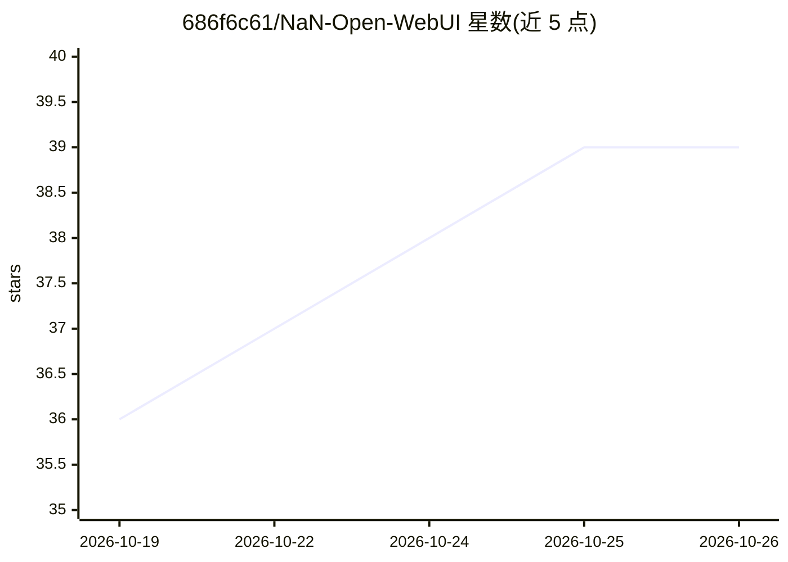

# 686f6c61/NaN-Open-WebUI

⭐ 39 · HTML · 推送 2026-10-18 · [GitHub](https://github.com/686f6c61/NaN-Open-WebUI) · 个人维护

**面向 NaN API 预配置的自托管 ChatGPT 式 Web 界面（Docker 部署）**

基于 Open WebUI 的 Docker 镜像，预配置连接 NaN 平台的模型目录（deepseek、glm5.3、qwen、mimo、gemma 等），提供聊天、视觉、Web 搜索（含自托管 SearXNG）、RAG、代码解释器、语音（whisper 听写/kokoro 朗读）、图像生成与编辑，以及带 39 个技能的终端容器。面向想自托管团队/社区聊天界面的用户：数据留在本机 Docker，仅 API key 发往 NaN；API 兼容 OpenAI 格式，换供应商只改 URL。支持多用户角色与按组的模型访问控制，单容器模式不含 Web 搜索。

## 筛选速览

| 维度 | 判定 | 备注 |
|---|---|---|
| AI 角色 | `ai-native` | 本体是模型或模型工具 |
| 许可风险 | `none` | — |
| 部署形态 | `self-host` | docker 或自建部署 |
| 模型依赖 | locked-api |  |
| 硬件要求 | — | 无带数字的原话,不猜 |
| 安装摩擦 | `low` | 无编译、无系统依赖或容器化 |
| 成熟度 | — | 结构信号不足 |

## 能力要点

- Open WebUI 预配置 NaN 模型目录，发布为 GHCR Docker 镜像
- 聊天/视觉/RAG 混合检索/语音/图像生成编辑/代码解释器一站式能力
- 多用户角色与按组模型访问控制，注册默认关闭
- 39 个终端技能在隔离容器中生成 Word/PPT/Excel/PDF 等产物

## 适用场景

- 两分钟内自托管一个接入 NaN 模型的 ChatGPT 式界面
- 为团队或社区搭建多用户聊天服务并管理访问权限
- 在自己的文档上做 RAG 问答并生成/编辑图片

## 场景标签

`聊天机器人` `图像生成` · 领域:对话与助手

## 证据(README 行号)

> L19: Una interfaz web tipo ChatGPT (Open WebUI)
> L46: - **Open WebUI** (la UI self-hosted de referencia) preconfigurada para NaN, publicada
> L49: - **Modelos de NaN** disponibles desde el selector:

## 星数曲线

2026-10-19 36 → 2026-10-26 39（+3）

---
*卡片 v1 · prompt 1.4 · 生成 2026-10-25 · 置信度 mid · 依据 README sha `6a15e92e9531` · [字段定义](../../DATASET.md)*
