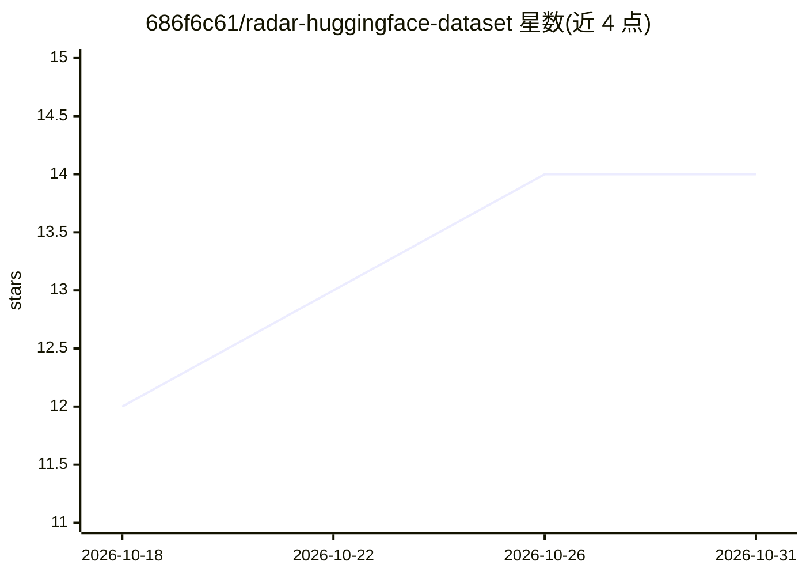

# 686f6c61/radar-huggingface-dataset

⭐ 14 · JavaScript · NOASSERTION · 推送 2026-10-30 · [GitHub](https://github.com/686f6c61/radar-huggingface-dataset) · [官网](https://radar-huggingface.686f6c61.dev) · 个人维护

**HuggingFace 模型生态的开策展数据集：西语模型档案与退出追踪**

由 HF//RADAR 生成的开源数据集仓库，每日三次增量更新 HuggingFace 模型生态：每模型提供规范化 JSON 元数据（许可证分类、实际参数量、格式、KPI）与一份由 LLM 撰写的西班牙语技术档案。记录被撤下模型的 removed 标记与日期，仅收录验证过开源许可证的模型。通过 git 提交历史与不可变编号 release 保留可审计时间序列，支持 curl 单文件、pandas bulk 与 DuckDB 直查。声明档案由 LLM 撰写可能含错误。

## 筛选速览

| 维度 | 判定 | 备注 |
|---|---|---|
| AI 角色 | `ai-knowledge` | 知识聚合/清单类 |
| 许可风险 | `none` | NOASSERTION |
| 部署形态 | `None` |  |
| 模型依赖 | — | README 未给出锁定关系 |
| 硬件要求 | — | 无带数字的原话,不猜 |
| 安装摩擦 | `low` | 无编译、无系统依赖或容器化 |
| 成熟度 | — | 结构信号不足 |

## 能力要点

- 每模型提供规范化 JSON 元数据 + 西语技术档案（data/author/model 双文件）
- 撤下模型保留 removed/removed_at 标记，不删除文件
- 每日三次增量更新，git 历史与不可变编号 release 构成时间序列快照
- 支持 curl 直取、pandas 读 bulk jsonl.gz、DuckDB 免下载直查

## 适用场景

- 分析 HuggingFace 上谁在发布、用什么许可证与格式的模型
- 追踪模型下载量、likes 与 trending 的时段变化而非历史累计
- 发现哪些模型已从 Hub 撤下
- 获取西班牙语撰写的模型技术档案与限制说明

## 场景标签

`精选清单` · 领域:学习与行业

## 证据(README 行号)

> L12: **Radar HuggingFace Dataset** es un dataset abierto, vivo y versionado del
> L20: Lo genera **HF//RADAR**, un radar
> L22: técnica en castellano. Este repo es su salida de datos: metadatos

## 星数曲线

2026-10-18 12 → 2026-10-31 14（+2）

---
*卡片 v1 · prompt 1.4 · 生成 2026-10-31 · 置信度 high · 依据 README sha `2d64a9a9db4d` · [字段定义](../../DATASET.md)*
