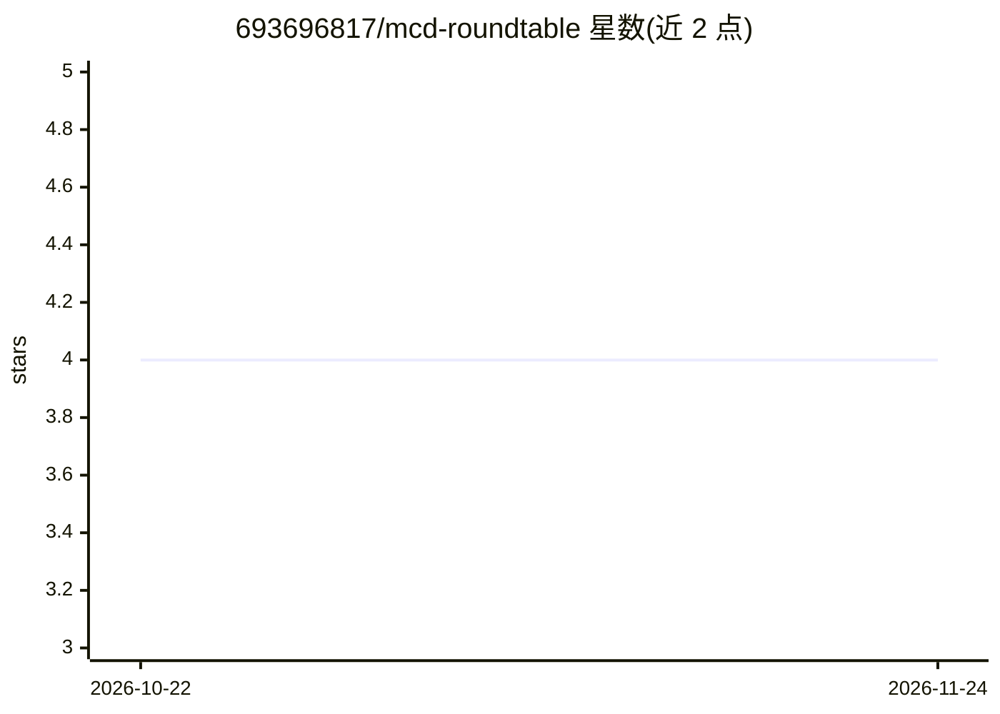

# 693696817/mcd-roundtable

⭐ — · [GitHub]() · 个人维护 · 中文 README

**五个 AI 人格辩论，用麦当劳官方 MCP 算出可下单的方案**

基于麦当劳中国官方 MCP Server（mcd-mcp）的多智能体点餐决策 CLI/Skill：五个立场不同的 AI 委员对一句话需求辩论，菜单、券、营养、价格均来自官方接口，金额只认 calculate-price 真实试算，模型不估算价格，最后由确定性求解器定案。支持 --order 返回官方支付链接、导出 SVG/单文件 HTML/JSON。无 LLM Key 时退回规则大脑仍可运行；--demo 模式离线、零配置可用。需申请麦当劳 MCP Token 才能接真实数据。

## 筛选速览

| 维度 | 判定 | 备注 |
|---|---|---|
| AI 角色 | `ai-native` | 本体是模型或模型工具 |
| 许可风险 | `permissive` | — |
| 部署形态 | `library` | 以包/库形式分发 |
| 模型依赖 | local-ok | 支持本地模型 |
| 硬件要求 | — | 无带数字的原话,不猜 |
| 安装摩擦 | `low` | 无编译、无系统依赖或容器化 |
| 成熟度 | — | 结构信号不足 |

## 能力要点

- 金额只来自官方 calculate-price 试算，兜底价显式标注 local-fallback
- 五个 AI 委员辩论 + 确定性求解器裁决的多智能体流程
- 不配 LLM Key 时自动退回 HeuristicBrain 规则大脑，功能完整
- 支持 --demo 离线运行（内置与真机同构的原始报文）

## 适用场景

- 一句话点餐并按预算、蛋白质、用券等约束拿到可下单方案
- 找到加一件反而实付更少的凑单解
- 把点餐决议导成 SVG 卡或单文件网页分享
- 以 --json 输出接入自己的 Agent 工作流

## 场景标签

`多智能体` · 领域:Agent 开发

## 证据(README 行号)

> L5: **麦门圆桌（`mcd-roundtable`）**是一个跑在**麦当劳中国官方 MCP Server**（`mcd-mcp`）上的
> L6: **多智能体点餐决策 Skill / 命令行工具** —— 模型负责「吵」，官方接口负责「算」。
> L34: |**它是什么**|基于**麦当劳官方 MCP** 的**多智能体（multi-agent）点餐决策**命令行工具 / AI Agent Skill|

## 星数曲线

2026-10-22 4 → 2026-11-24 4（+0）

---
*卡片 v1 · prompt 1.4 · 生成 2026-11-21 · 置信度 high · 依据 README sha `d39d4e4319ea` · [字段定义](../../DATASET.md)*
