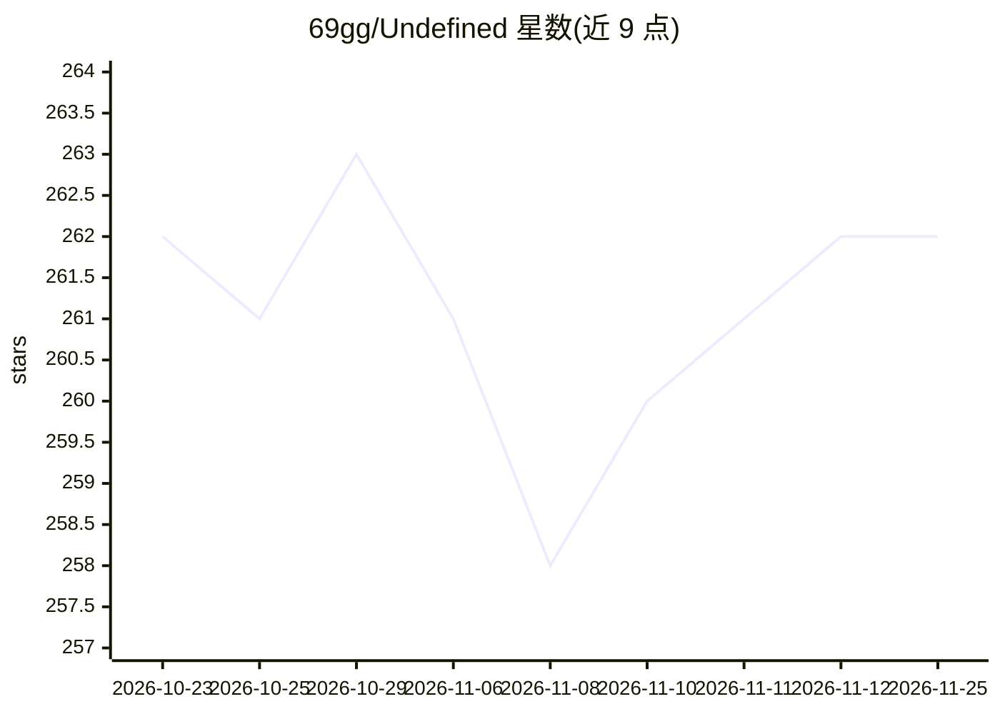

# 69gg/Undefined

⭐ 262 · Python · MIT · 推送 2026-11-17 · [GitHub](https://github.com/69gg/Undefined) · 个人维护 · 中文 README

**通过 OneBot V11 接入 QQ/微信的多 Agent 机器人平台**

基于 Python 异步架构的机器人平台，以 OneBot V11 协议接入 QQ（支持 NapCat 等协议端），并可通过微信 ClawBot/iLink 接入微信私聊。核心机制包括三层认知记忆架构（向量数据库存储、语义检索、时间衰减加权）、自研 Skills 系统分层管理工具与 Agent、MCP 协议扩展及 Anthropic Skills 支持。提供 WebUI 在线管理、跨平台桌面/移动客户端，可作为 Python 库嵌入使用。README 提示依赖第三方协议端接入平台存在账号风控与封禁风险。

## 筛选速览

| 维度 | 判定 | 备注 |
|---|---|---|
| AI 角色 | `ai-native` | 本体是模型或模型工具 |
| 许可风险 | `permissive` | MIT |
| 部署形态 | `desktop` | 安装包/桌面程序 |
| 模型依赖 | — | README 未给出锁定关系 |
| 硬件要求 | — | 无带数字的原话,不猜 |
| 安装摩擦 | `low` | 无编译、无系统依赖或容器化 |
| 成熟度 | — | 结构信号不足 |

## 能力要点

- 三层认知记忆架构：短期记忆、向量数据库认知记忆、置顶备忘录
- Skills 架构分层管理 Tools 与 Agents，支持热重载与按需工具加载
- 多模型池配置，支持轮询、随机或并发比较择优
- WebUI 管理控制台，配 Tauri v2 跨平台 Console 与 Chat 客户端

## 适用场景

- 部署 QQ 群聊/私聊机器人，自动处理链接提取与内容分析
- 搭建带长期记忆的个人 AI 助手，跨群聊联动记忆
- 通过 WebUI 画布编排消息触发的自动化工作流
- 作为 Python 库嵌入脚本复用 Skills 与认知记忆组件

## 场景标签

`聊天机器人` `Agent 记忆` `多智能体` `工作流自动化` · 领域:Agent 开发

## 证据(README 行号)

> L14:  Undefined 是一个基于 Python 异步架构的高性能机器人平台，以 OneBot V11 接入 QQ，并可通过微信 ClawBot/iLink 接入微信私聊。项目搭载 认知记忆架构 ，采用自研 Skills 系统，内置
> L28: - **Skills 架构**：全新设计的技能系统，将基础工具（Tools）与智能代理（Agents）分层管理，支持自动发现与注册。

## 星数曲线

2026-10-23 262 → 2026-11-25 262（+0）

---
*卡片 v1 · prompt 1.4 · 生成 2026-11-25 · 置信度 high · 依据 README sha `6e912a901807` · [字段定义](../../DATASET.md)*
