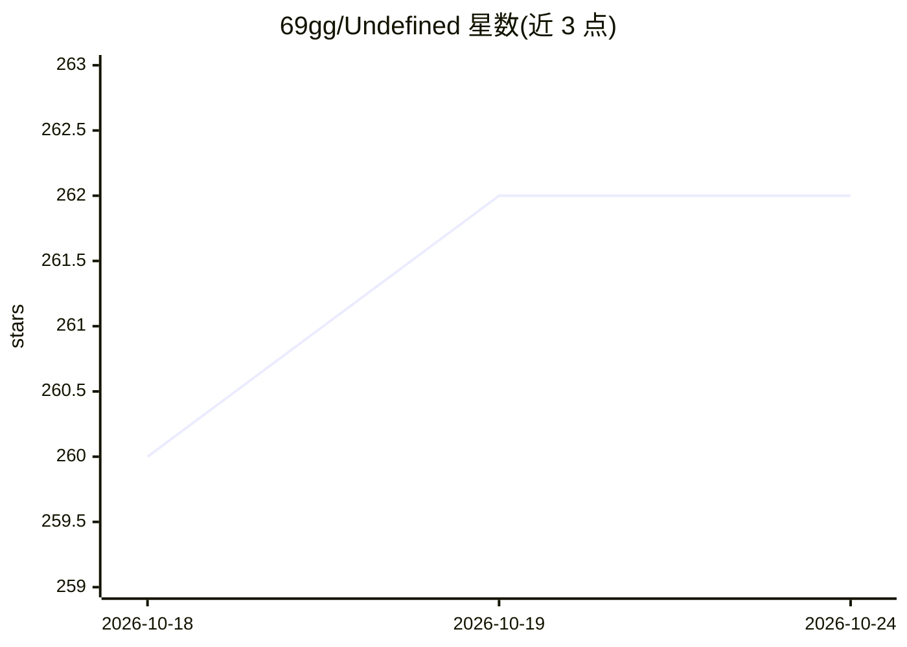

# 69gg/Undefined

⭐ 261 · Python · MIT · 推送 2026-10-24 · [GitHub](https://github.com/69gg/Undefined) · 个人维护 · 中文 README

**QQ/微信 AI 机器人平台：认知记忆+多 Agent 技能系统**

基于 Python 异步架构的机器人平台，通过 OneBot V11 协议（如 NapCat）接入 QQ，并经 ClawBot/iLink 接入微信私聊。内置三层记忆（短期备忘、向量认知记忆、置顶备忘录）、Skills 技能系统与多个专业 Agent，支持 MCP、Anthropic Skills、本地知识库（ChromaDB）、多模型池、表情包库、自动化工作流及 Bilibili/arXiv/GitHub/音乐等工具。提供 WebUI 管理与 Tauri 跨平台客户端，也可 pip 安装作为 Python 库嵌入。需自行部署协议端与模型 API，README 明示账号风控与封禁风险。

## 筛选速览

| 维度 | 判定 | 备注 |
|---|---|---|
| AI 角色 | `ai-native` | 本体是模型或模型工具 |
| 许可风险 | `permissive` | MIT |
| 部署形态 | `desktop` | 安装包/桌面程序 |
| 模型依赖 | — | README 未给出锁定关系 |
| 硬件要求 | — | 无带数字的原话,不猜 |
| 安装摩擦 | `low` | 无编译、无系统依赖或容器化 |
| 成熟度 | — | 结构信号不足 |

## 能力要点

- 三层分层记忆：短期备忘、向量认知记忆（史官异步改写+语义检索）、置顶备忘录
- Skills 架构分层管理工具与 Agent，支持热重载、按需工具加载与 callable.json 跨 Agent 调用
- OneBot V11 接入 QQ，微信 ClawBot/iLink 私聊映射为逻辑 QQ 身份共享记忆与权限
- 可 pip install Undefined-bot 作为 Python 库嵌入，复用 Skills/认知记忆/AIClient 组件

## 适用场景

- 搭建有长期记忆的 QQ/微信 AI 群聊或私聊机器人
- 通过 WebUI 远程管理配置、日志、记忆与 Bot 启停
- 用独立 Chat/Console 客户端在桌面或 Android 上对话或管理
- 以 Python 库形式复用其 Skills 注册表与认知记忆组件

## 场景标签

`聊天机器人` `Agent 记忆` `多智能体` · 领域:Agent 开发

## 证据(README 行号)

> L14:  Undefined 是一个基于 Python 异步架构的高性能机器人平台，以 OneBot V11 接入 QQ，并可通过微信 ClawBot/iLink 接入微信私聊。项目搭载 认知记忆架构 ，采用自研 Skills 系统，内置
> L2:  QQ and WeChat bot platform with cognitive memory architecture and multi-agent Skills.

## 星数曲线

2026-10-18 260 → 2026-10-24 262（+2）

---
*卡片 v1 · prompt 1.4 · 生成 2026-10-22 · 置信度 high · 依据 README sha `21529983edfe` · [字段定义](../../DATASET.md)*
