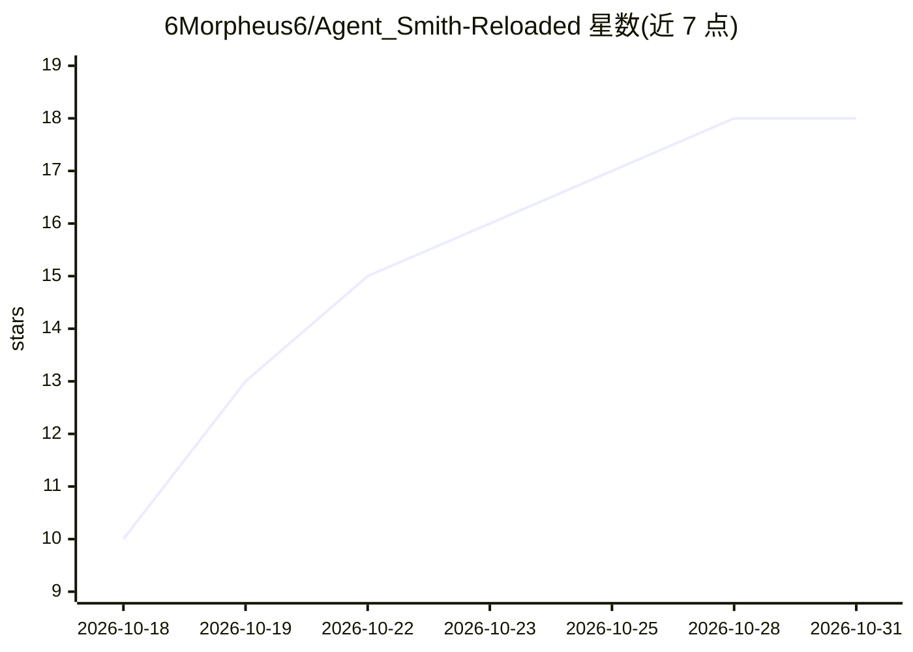

# 6Morpheus6/Agent_Smith-Reloaded

⭐ 18 · JavaScript · MIT · 推送 2026-10-25 · [GitHub](https://github.com/6Morpheus6/Agent_Smith-Reloaded) · 个人维护

**本地优先的桌面自主编程 agent，接本地模型无需 API key**

基于 Electron 的桌面 AI 编程助手，面向消费级硬件（32GB VRAM 版本）：通过 LM Studio 本地服务器运行 Gemma、Qwen 等 7B–35B 模型，无需云端 API key。核心机制为三模式隔离（Chat/Agent/Code）、任务自动路由分类器、多轮 Code Mode 循环（探索→计划→写入→验证）、字节级 changeLedger 记录与一键 Revert All 回滚、Git worktree 隔离，以及路径防护、命令黑名单等安全栏栅。内置 all-MiniLM-L6-v2 嵌入模型做本地语义记忆，支持二维码远程手机监控与插件系统。VRAM 低于 32GB 用户需用不含编程管线的 resurrected 版本。

## 筛选速览

| 维度 | 判定 | 备注 |
|---|---|---|
| AI 角色 | `ai-native` | 本体是模型或模型工具 |
| 许可风险 | `permissive` | MIT |
| 部署形态 | `library` | 以包/库形式分发 |
| 模型依赖 | — | README 未给出锁定关系 |
| 硬件要求 | `gpu-24g` | |
| 安装摩擦 | `low` | 无编译、无系统依赖或容器化 |
| 成熟度 | — | 结构信号不足 |

## 能力要点

- Code Mode 多轮自主循环：计划、实现、自校验、验证变更
- changeLedger 记录所有文件改动，支持一键字节级 Revert All
- 通过 LM Studio 运行本地模型（Gemma/Qwen 等 7B–35B），无需 API key
- 内置 all-MiniLM-L6-v2 本地嵌入模型提供零配置语义记忆

## 适用场景

- 在本机让本地模型自主完成代码修改、bug 修复并自验证
- 通过可视化 diff 与一键回滚审查 agent 改动，保证工作区安全
- 用手机扫码远程监控构建过程并下载主机文件
- 在隔离的 Git worktree 中试验性构建而不影响主分支

## 场景标签

`编码 Agent` `Agent 记忆` · 领域:Agent 开发

## 证据(README 行号)

> L28: **Agent Smith reloaded** is an elite desktop developer's cockpit that transforms locally hosted language models (7B
> L39: * **🛠️ Autonomous "Code Mode":** A dedicated multi-turn agent loop that plans, implements, self-corrects, and valid

## 星数曲线

2026-10-18 10 → 2026-10-31 18（+8）

---
*卡片 v1 · prompt 1.4 · 生成 2026-10-29 · 置信度 high · 依据 README sha `40f609868252` · [字段定义](../../DATASET.md)*
