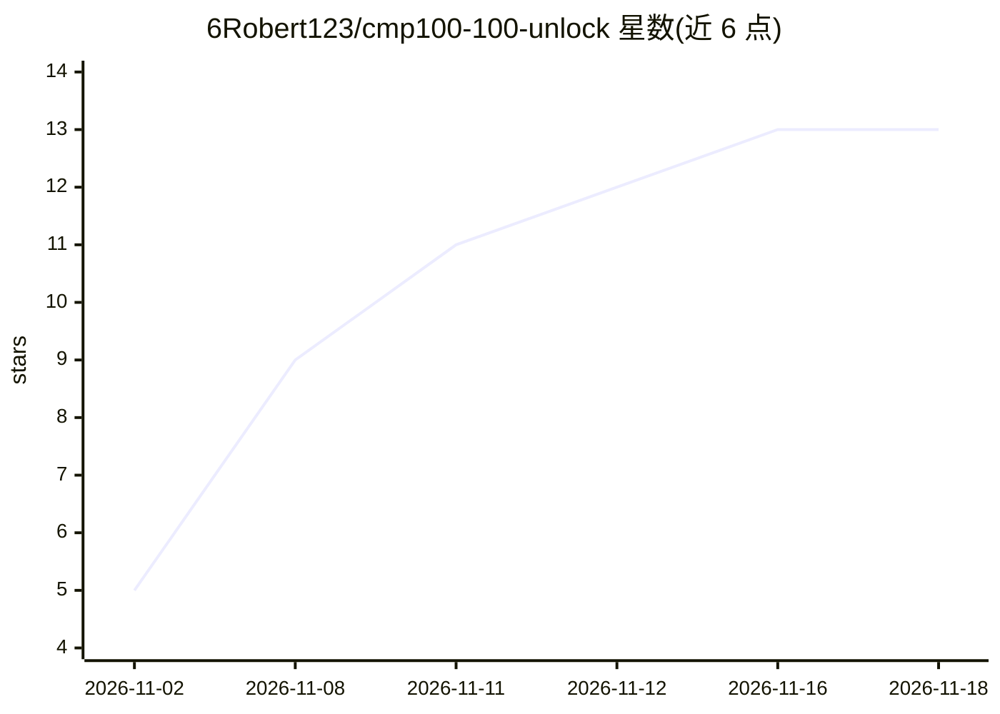

# 6Robert123/cmp100-100-unlock

⭐ 13 · C · MIT · 推送 2026-11-04 · [GitHub](https://github.com/6Robert123/cmp100-100-unlock) · 个人维护

**在 Linux 上将 CMP 100-100 挖矿卡显存从 6GB 解锁到 12GB 的脚本**

针对二手约 $25 的 NVIDIA CMP 100-100（GP100/Pascal）挖矿卡的 Linux 显存解锁工具：单个 shell 脚本内嵌 Python 3.8+ 控制器与带源码的 helper，通过向选定 CMP 设备发送 unbind/reset/config/override/bind 写入，使驱动报告 12288 MiB。提供 --check/--apply/--install-boot 流程、离线哈希校验脚本与证据表格，未实现 PCIe Gen2 与物理 x16，混合主机与冷启动路径未经验证。

## 筛选速览

| 维度 | 判定 | 备注 |
|---|---|---|
| AI 角色 | `ai-enhanced` | 去掉 AI 部分产品仍成立 |
| 许可风险 | `permissive` | MIT |
| 部署形态 | `None` |  |
| 模型依赖 | — | README 未给出锁定关系 |
| 硬件要求 | — | 无带数字的原话,不猜 |
| 安装摩擦 | `high` | 编译与系统依赖俱全 |
| 成熟度 | — | 结构信号不足 |

## 能力要点

- 单文件脚本：内嵌控制器与已开源的 helper C 源码，可自行 gcc 编译复现
- --check/--apply/--install-boot 分步流程，支持选定 BDF 子集操作
-  refuses 共享 reset 桥或无法归属的活跃客户端，保护同主机其他 GPU
- 提供 check_bundle.py 离线校验哈希与 helper 一致性

## 适用场景

- 把手头的 CMP 100-100 挖矿卡改造成可用于本地 LLM 推理的 12GB 显存卡
- 在 Linux x86_64 主机上按脚本流程初始化并校验解锁结果
- 复现/研究 GP100 CFG1 初始化机制并贡献 Gen2/x16 相关实验

## 场景标签

 · 领域:硬件/驱动工具

## 证据(README 行号)

> L1: # 🔓 NVIDIA CMP 100-100 12GB unlock (GP100, Linux)
> L5: Hi, I'm **6Robert123** 👋 I picked up an NVIDIA CMP 100-100 (GP100 / Pascal) second-hand for about $25. It's a mining
> L11: - **What:** initializes an NVIDIA CMP 100-100 (GP100) on Linux so the driver reports 12288 MiB instead of 6144 MiB.

## 星数曲线

2026-11-02 5 → 2026-11-18 13（+8）

---
*卡片 v1 · prompt 1.4 · 生成 2026-11-18 · 置信度 high · 依据 README sha `f14911ea9d09` · [字段定义](../../DATASET.md)*
